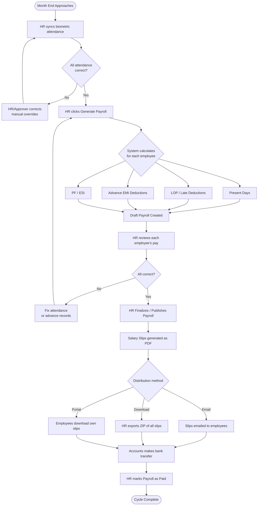
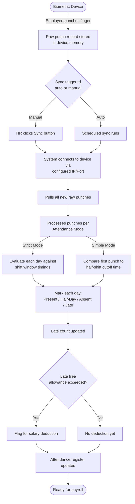
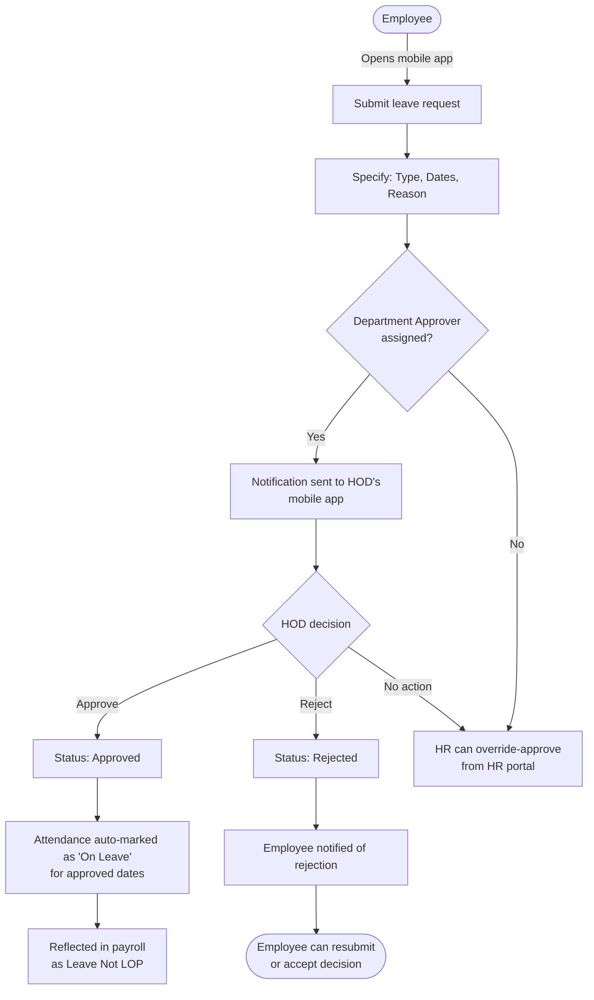
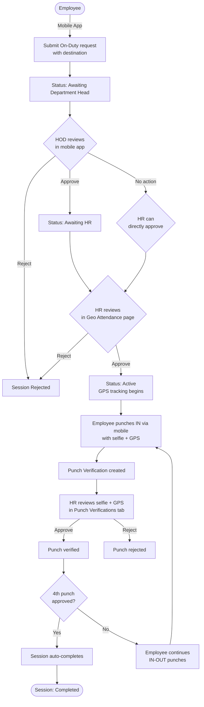
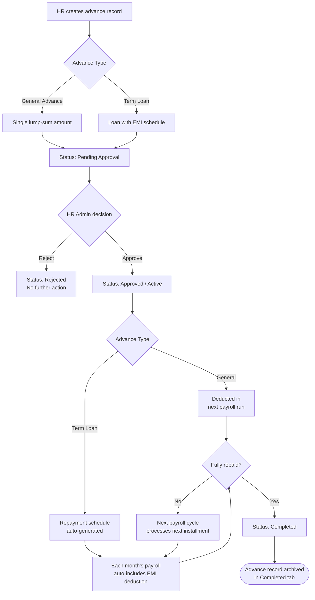

# UK Textiles ERP — Complete Workflow & User Guide

> **A practical, non-technical guide for everyone who uses this system — HR, Admin, Department Heads, and Employees.**

---

## Table of Contents

1. [System Overview](#1-system-overview)
2. [User Roles & Who Does What](#2-user-roles--who-does-what)
3. [How to Log In & Navigate](#3-how-to-log-in--navigate)
4. [HR Module — Page-by-Page Guide](#4-hr-module--page-by-page-guide)
   - [4.1 HR Dashboard](#41-hr-dashboard)
   - [4.2 Employees](#42-employees)
   - [4.3 Attendance](#43-attendance)
   - [4.4 Geo Attendance & On-Duty Tracking](#44-geo-attendance--on-duty-tracking)
   - [4.5 Staff Payroll](#45-staff-payroll)
   - [4.6 Production Payroll](#46-production-payroll)
   - [4.7 Settlement (Advances & Loans)](#47-settlement-advances--loans)
   - [4.8 Recruitment Dashboard](#48-recruitment-dashboard)
   - [4.9 User Management (Department Approvers)](#49-user-management-department-approvers)
   - [4.10 Settings](#410-settings)
   - [4.11 Managing Director (MD) Portal & AI Assistant](#411-managing-director-md-portal--ai-assistant)
5. [Employee Self-Service Module](#5-employee-self-service-module)
   - [5.1 Employee Dashboard](#51-employee-dashboard)
   - [5.2 Leave Management](#52-leave-management)
   - [5.3 Salary Slips](#53-salary-slips)
   - [5.4 Profile](#54-profile)
   - [5.5 Notifications](#55-notifications)
   - [5.6 Compensation](#56-compensation)
   - [5.7 HOD Assignment](#57-hod-assignment)
6. [End-to-End Workflow Diagrams](#6-end-to-end-workflow-diagrams)
   - [6.1 Monthly Payroll Workflow](#61-monthly-payroll-workflow)
   - [6.2 Attendance Sync Workflow](#62-attendance-sync-workflow)
   - [6.3 Leave Request Workflow](#63-leave-request-workflow)
   - [6.4 On-Duty (Field Visit) Workflow](#64-on-duty-field-visit-workflow)
   - [6.5 Advance / Loan Workflow](#65-advance--loan-workflow)
7. [Key Concepts Explained](#7-key-concepts-explained)
8. [Common Tasks — Step by Step](#8-common-tasks--step-by-step)
9. [What You Should and Should Not Do](#9-what-you-should-and-should-not-do)
10. [Onboarding Checklist for New Users](#10-onboarding-checklist-for-new-users)

---

## 1. System Overview

The **UK Textiles ERP** is an integrated Human Resources and Payroll management system built specifically for a garments manufacturing environment. It manages the **entire employee lifecycle** — from the moment someone is hired, through day-to-day attendance tracking, leave requests, salary generation, advances, and eventually separation.

### What Does This System Handle?

| Area | What it manages |
|------|----------------|
| **Employee Records** | All employee personal, professional, and document data |
| **Attendance** | Daily punch-in/punch-out from biometric devices; manual overrides; shift tracking |
| **Leave & Permissions** | Requests, approvals, and balances for all types of leave |
| **Payroll — Staff** | Monthly salary generation for office/admin staff with proper deductions |
| **Payroll — Production** | Shift-segment–based payroll for factory floor workers |
| **Advances & Loans** | General and term-loan cash advances with automatic EMI deduction from payroll |
| **Geo-Attendance** | GPS-based tracking for employees on field/client visits ("On-Duty") |
| **Recruitment** | Vacancy tracking, department headcount, new joinee monitoring |
| **Documents** | Auto-generation of Offer Letters, Appointment Letters, ID Cards, Salary Slips |
| **System Settings** | Company profile, payroll config, biometric devices, backup/restore |

### Two Types of Users

The system is split into two separate portal views:

- **HR Portal** — Full management view used by HR staff, admins, and management.
- **Employee Portal** — A simplified self-service view where individual employees check their own attendance, apply for leave, and download their salary slips.

---

## 2. User Roles & Who Does What

### Role Hierarchy

```
Super Admin
    │
    └── Admin (Full HR access)
            │
            ├── HR Staff (access per assigned modules)
            │
            ├── Department Heads / Approvers (mobile app approval)
            │
            └── Employees (self-service portal only)
```

### Role Descriptions

#### 🔑 Super Admin
- Has unrestricted access to every feature in the system.
- Is the only role that can perform **automated database restores** (restoring from a backup file).
- Manages all other user accounts and permission levels.
- Should be used sparingly — only for system-level operations.

#### 👤 Admin / HR Admin
- Full access to all HR modules: employees, attendance, payroll, settings.
- Creates new employee records and manages the full employee lifecycle.
- Runs payroll generation and issues salary slips.
- Approves or rejects advances/loans.
- Sets up biometric devices and attendance policies.
- Configures document templates (offer letters, ID cards, etc.).
- Manages backup and data integrity.

#### 👥 HR Staff (Restricted Access)
- Access to specific HR modules as assigned by the admin.
- Each module can be set to **Full Access**, **View Only**, or **Hidden** for each HR user.
- Examples: An HR staff member may have full access to Attendance but only view-only access to Payroll.
- Permissions are managed via **Account Management** (accessible to Admin).

##### Account Management (Admin only)
- **Summary:** cards at the top count the accounts (and how many are tied to one branch), the active and the disabled ones, and the roles. A yellow note lists accounts that have **no role**: they can't open any module until one is given (an administrator needs no role and is never counted).
- **Accounts tab:** search by username, name, email, role or branch (every word you type has to match), narrow by **Active / Disabled**, **role** or **branch** (including "Company-wide only"), and sort by any column heading. Each row shows who the person is, their role and branch, whether the login is active, and when they last signed in. Edit, disable/enable and delete sit at the end of the row; deleting asks for confirmation first. The administrator account can be edited but not disabled or deleted.
- **Roles & Permissions tab:** each role shows how many accounts use it (click to see them) and a bar of how much it opens up: *edit*, *view* only and *hidden* modules. Deleting a role that is in use tells you how many accounts will be left without one.
- **Role editor:** every module has a **Hidden / View / Edit** switch. A section with sub-modules (Employees, Settings...) folds open; a sub-module with no setting of its own **follows its section**, and shows a ↺ button to go back to following it once you have set it yourself. Use the search box to find a module, **Set every module to...** for a quick start, and **Copy from another role** to begin from an existing role (nothing is saved until you press **Save**). Closing the editor with unsaved changes asks first. Role names must be unique.
#### 🏗️ Department Head / Approver (HOD)
- Not a separate login type — these are **regular employees** who have been designated as approvers via **User Management**.
- They use the **mobile app** to approve or reject:
  - Leave requests
  - Permission/half-day requests
  - Attendance correction requests
  - Resignation requests
  - On-Duty (field visit) sessions
  - Holiday / Sunday work compensation claims that HR raises
- They can be assigned to cover specific departments or individual employees.

#### 👷 Employee
- Has access only to the Employee Self-Service portal.
- Can view their own attendance, leave balances, and salary slips.
- Can apply for leave or permission through the mobile app.
- Cannot see any other employee's data.

---

## 3. How to Log In & Navigate

### Logging In
1. Open the application in a web browser.
2. Enter your **Employee Code** (or username) and **Password**.
3. The system automatically redirects you to the correct portal based on your role:
   - HR staff → HR Portal
   - Regular employees → Employee Portal

### HR Portal Navigation
The HR portal has a **sidebar** on the left with sections for each module. On mobile, tap the hamburger menu (☰) in the top-left to open it.

**Important:** If a module shows a banner reading *"View only — browse and inspect freely, changes can't be saved,"* it means your account only has read access for that section. You can still see all the data, but cannot make any changes.

### Session & Security
- Sessions expire after a period of inactivity; you will be redirected to the login page.
- Always **log out** when using a shared computer.

---

## 4. HR Module — Page-by-Page Guide

---

### 4.1 HR Dashboard

**What it's for:** The first page you see after logging in as HR. It gives a real-time overview of the most important numbers across the entire organization.

**What you see:**

| Card | What it shows |
|------|--------------|
| Total Employees | How many active employees are in the system |
| Present Today | How many employees are marked present today (from biometric sync) |
| On Leave | Employees on approved leave today |
| New Joiners (30 days) | Employees who joined in the last 30 days |
| Pending Leaves | Leave requests waiting for approval |
| Pending Approvals | All pending action items |
| Biometric Sync | Status of the last biometric device sync |

**Quick Actions:** The dashboard has shortcuts to common tasks:
- Sync Attendance (pull today's data from fingerprint machines)
- Go to Employee list
- Start Payroll generation

**When to use it:** Start here every day to check the overall pulse of the organization and spot urgent items.

---

### 4.2 Employees

**What it's for:** The complete employee directory. This is where all employee records live.

#### Employee List View
- Displays all employees with their photo (if uploaded), name, employee code, department, designation, and status.
- Use the **search bar** to find an employee by name, code, or department.
- Filter by **Active / Inactive / All**.
- Filter by **Department** or **Employment Type**.

#### Adding a New Employee
Click **Add Employee** (top right). Fill in:
- Personal details: Name, date of birth, gender, blood group, contact info
- Professional details: Employee code, department, designation, date of joining
- Salary details: Basic salary, allowances, PF/ESI membership
- Documents: Upload Aadhaar, PAN, photographs, etc.

> **Important:** The employee code is the system's unique identifier for an employee. It cannot be changed after it's used in any attendance or payroll record. Choose it carefully (e.g., format like `EMP001`).

##### Salary Split (50% + 50%)

For a salaried employee (Salary Type **Monthly** or **Weekly**) the salary is always divided into two equal halves:

| Portion | Share | Made up of |
|---|---|---|
| **First portion** | 50% of the salary | Basic + DA + Retaining Allowance |
| **Second portion** | 50% of the salary | Other Allowance + Petrol Allowance + HRA + Special Allowance + CA |

- **It fills itself in.** As soon as you type the Salary Amount, all eight amounts appear (each portion is shared equally between its components, and if the salary has an odd paisa it goes to the first portion). Type a different salary and they are worked out again.
- **You can change any amount.** For example, put most of the first portion into Basic. The two portions show a live total with a green tick when correct or how much is over / short in red.
- **The 50% + 50% rule is mandatory.** Save is blocked until each portion is exactly half of the salary (so the two halves add up to the salary). **Reset to automatic split** puts the equal split back.
- **Older employees** with no split on record get a suggested split on their Edit page; saving records it. Employees paid **per shift** (Production) have no monthly amount, so no split.
- **When the salary changes** (Edit Employee, an Increment, or a bulk update) the split is re-worked to the new salary, keeping the way each half was shared.
- **Bulk upload:** the last eight template columns (Basic … CA) hold the split. Leave them blank and it is done for you; if you fill them, blanks count as 0 and each half must be exactly 50%. A template downloaded before these columns existed still uploads. So does one downloaded before two column names were corrected (RHA is now **HRA**, Retention Allowance is now **Retaining Allowance**): the old headers are read as the new ones.
- **Nothing else changes.** The split is a record of how the salary is made up; payroll, attendance and salary slips still calculate from the Salary Amount exactly as before.

#### Employee Profile
Click any employee's name to open their full profile. The profile is split into tabs:

| Tab | Contents |
|-----|----------|
| **Overview** | Personal & professional details, contact info |
| **Attendance** | Monthly attendance summary for this employee |
| **Leave** | Leave history and remaining balances |
| **Payroll** | Salary history for this employee |
| **Documents** | Upload/download KYC documents, offer letters, etc. |
| **ID Card** | Preview and generate the employee's ID card |

#### Bulk Operations
On the employee list, select multiple employees using the checkboxes to:
- **Export** employee data to Excel
- **Bulk update** department or designation
- **Deactivate** employees who have left

#### Employee Bulk Upload (Employees → Bulk Upload)
Add many employees at once, or fix many existing ones, with Excel. **Staff and Production are separate**: pick one first, and everything below it is for that kind only.

- **Add new employees:** download the **Staff** or **Production** template (each has its own columns: Staff has Salary Type, Salary Amount and the 50%+50% split; Production has Salary Per Shift), fill it in and upload it. Rows starting with `SAMPLE` are examples and are always skipped. Only Employee Code and First Name are required. A Production sheet uploaded in the Staff section (or the other way round) is refused with a clear message.
- **Active employees / Inactive employees:** download the active (or inactive) employees of that kind, edit the cells you want to change, and upload the file back. Rows are matched by Employee Code, a blank cell never erases stored data, and a **Status** column (Active / Inactive) lets you retire someone or bring them back. A row from another list (for example a Production employee in the Staff file) is refused.
- **Departments and designations are created for you.** If a row names a department or a designation that does not exist yet (say "Quality Checker"), it is created and given to that employee: the designation under the employee's department, the department in the employee's branch. Spelling is matched ignoring capitals and extra spaces, and "-", "N/A" or "nil" mean *none*. The check lists what **will be created**, and after the upload what **was created**, so a typo shows up before it becomes a new designation.
- **Big files:** up to 5,000 employees and 10 MB per file. If a file is too big to process in one go the server tells you, **changes nothing**, and says how many rows to split it into; when you upload the parts, leave *employees not in the file* on **Keep**.
- **Every file is checked first.** Nothing is saved when you choose the file: you see every row and what would happen to it, then press **Import / Apply**. The result shows the tallies and, for every row, the Excel row number, the employee code and name, the outcome (Created, Updated, Unchanged, Duplicate, Invalid, Failed, Not found, Skipped) and the reason or the fields that changed. **Needs attention** lists only the rows that did not go through. **Report** downloads the same as an Excel file.
- **Employees missing from an update file:** if people of that kind are not in the file you uploaded, you are asked what to do with them: **leave them as they are** (the default), **make them Inactive**, or **delete them and all their data**. You can decide one by one, and deleting asks you to type DELETE. Nothing is ever removed on its own.

#### Separating an Employee (Making Inactive)
When an employee resigns or is terminated:
1. Go to their profile.
2. Change their status to **Inactive** and set the Last Working Day.
3. Their attendance will stop being synced from that date.
4. They will no longer appear in payroll generation.
5. Their employee portal login is also disabled.

#### What NOT to do in the Employee section
- ❌ Do not delete an employee record — mark them as Inactive instead, so historical records (attendance, payroll) are preserved.
- ❌ Do not change an employee's code after it has been used in attendance or payroll.
- ❌ Do not add duplicate employees (one person, two records).

---

### 4.3 Attendance

**What it's for:** Tracks daily attendance for all employees. This is the most critical page for payroll accuracy.

#### Understanding Attendance in this System

The system supports two distinct attendance modes, configured in **Settings → Attendance**:

| Mode | How it works |
|------|-------------|
| **Strict Mode** | Uses the biometric punch times to determine Present/Half-Day/Absent based on exact shift windows. An employee must punch IN within a configurable window around their shift start time, and must complete at least the first half of the shift to be marked Present. |
| **Simple Mode** | A cutoff-time–based approach: if the employee's first punch is before a configured time (e.g., 1:30 PM), they are marked for the first half. After that, second half only. |

#### The Biometric Sync Pipeline

This is a background process that automatically fetches raw punch records from the fingerprint devices and processes them into proper attendance records.

**Sync Status Indicators:**
- 🟢 **Synced** — Latest records fetched and processed
- 🟡 **Syncing** — Currently running
- 🔴 **Error** — Something went wrong; check the device connection

**When to sync:**
- The system syncs automatically at regular intervals.
- You can also trigger a manual sync from the Dashboard's quick action button or from the Attendance page.
- Always sync before generating payroll to ensure the data is current.

#### Biometric Device Status

**Biometric Connectors -> Biometric Device Status** (also the **Device Status** button on the Attendance page) is the one place to check whether every punching machine is connected to the server, and why one is not.

- **Summary cards:** devices configured, Connected, Disconnected, Errors, Unreachable, and punches received today. Click a card to list only those devices.
- **Each device** shows its name, IP address and serial number; a status (Connected, Disconnected, Error or Disabled); whether the server can reach it; when the server last heard from it; the last successful sync; and the connection delay in milliseconds, with slow connections marked.
- **Why isn't it connecting?** Open a device to see nine checks: Biometric device, Local network (LAN), Firewall, Port configuration, API connection, Railway deployment, Device IP configuration, Network timeout, and Authentication & configuration. Each is marked OK, Warning, Problem, Unknown or Not applicable, with the exact error message and what to do next. The most important finding is shown at the top of the card.
- **Run connection check** pings every enabled device, tests its port and reads its own settings. While it runs each device shows **Pinging...**. It needs permission to edit Attendance, and it never changes anything on a device.
- **Server & firewall setup** lists the address, port and settings each device must be given, with copy buttons.
- **Unknown senders** lists machines that are contacting the server but are not set up in Settings -> Devices.
- The page refreshes itself every 15 seconds; switch **Auto-refresh** off to stop that.

> From the cloud server, devices on the factory network (192.168.x.x) show **Unreachable**. That is expected, not a fault: what matters there is whether the device is **Connected**, meaning it is calling the server. To read a device's own settings, open the local app on a computer inside the factory and run the check there.

#### Device Control

**Biometric Connectors -> Device Control** is for the biometric machines themselves. It has three tabs.

**Overview** shows how many devices are configured, how many are **Connected** (this server can reach them right now) and how many are **Disconnected**, with the exact reason and what to do for each one. Every device card shows how full its memory is (users and attendance log, amber from 80%), its clock against the server's, when its users were last read, and shortcuts to Data Fetch and Data Push for that device.

**Data Fetch** pulls punches off the devices by hand and updates the HRMS. The HRMS already receives punches automatically; use this to be sure, or after a device was offline.
1. Tick the devices and choose the dates.
2. Press **Preview** to see how many punches the HRMS does not have yet (nothing is changed), then **Fetch and update HRMS** to add them. Punches the HRMS already has are never changed or deleted.
3. The result lists each device, the IDs on the devices that have no active employee (their punches are not recorded), and any day with six or more punches for one person. Earlier fetches stay in the history below.

**Data Push** shows everyone on every device and who they are in the HRMS.
- Click a device to see only the people on it, or use **Which device** to find who is on all of several devices, or who is *not* on a device. The cards above the list filter to *In the HRMS*, *Not in the HRMS* (on a device, no employee), *Not on a device* (in the HRMS, on none), *Inactive, still on one* and *On several devices*. You can also filter by role, staff or production, department, and "details differ between devices". The address always reflects the filters, so a view can be sent to someone.
- **Read all devices** refreshes the list from the machines; each device shows when it was last read. The search box waits for a pause in typing before it asks.
- The small coloured chips on each row are the devices. Click the chip of a device the person is on to change them as that device holds them (only that device is ticked to start with); click one they are not on to add them there.
- **Add user** puts a person on the devices you choose: pick an employee (or enter someone who is not in the HRMS), then the details the machine asks for: ID, name, role, card number, password, and a photo taken with the camera or uploaded (kept on the employee's HRMS profile). Tick the devices and press **Add**. The photo needs permission to edit employees, because it is saved on the employee's profile.
- **Edit** (pencil) changes what the devices hold; only the fields you change are sent. The ID is the Employee Code and cannot be changed here.
- **Add to more devices** (arrow) copies a person to other devices with the details the devices already hold; tick several rows to do it for many.
- **Delete** (bin) removes the person from the devices you tick. By default it also makes the employee **Inactive** in the HRMS; they are never deleted, so their record is there if they join again. The dialog says exactly what will happen first.

> These machines enrol faces on the device itself: a user added here has no face until the person enrols at the machine, and a photo taken here cannot be put on the machine. Device Control talks to the machines directly, so it needs the HRMS to be running where it can reach them (a computer in the factory); on the cloud server it says so instead of failing.

#### Site connectors

Some factories sit behind a network the cloud HRMS cannot reach, so Device Control shows their devices as Disconnected. A **site connector** fixes that: a small program installed once on a computer at the factory (on the same network as the devices). It reaches the devices from inside and reports to the HRMS over the internet, so **nothing has to be opened in the factory's firewall**. Everything on this page then works for those devices as for any other.

**Biometric Connectors -> Device Control -> Site connectors**
1. **Add a connector** and name it after the site. A **pairing code** (like `K7QM-4XWD`) is shown once; it works once and expires after a day.
2. Install the connector on a computer at the factory (the installer folder has the steps) and enter the HRMS address and the code. The connector's card turns **Online**.
3. In **Settings -> Devices**, choose the connector under **Connect via** for each device at that factory. Use the device's address on the factory network (192.168.x.x).

Each connector's card shows whether it is Online, Offline, switched off or waiting to be paired, when it was last heard from, which computer it is, each device it reaches (and why one does not answer), the last time it read the device's punches, and how many punches are waiting to be sent. **Settings** sets how often it reads punches (default every 15 minutes, last 2 days; the devices' own push of punches to the server carries on as before, this is the safety net behind it). **New pairing code** is for installing it again on another computer. **Disable connector** locks it out until you **Enable connector** again (you are asked to confirm: a change it is in the middle of is given up, and the page says the device may or may not have been changed); **Remove** sends its devices back to being connected directly. Someone whose role is limited to one branch can see that the connectors are there and how they are, but not the computers' names or addresses, and cannot add, change, re-pair or remove one (a connector serves every branch).

When you read users, add, change or delete users, or fetch punches for such a device, the request goes to the connector and the page waits for its answer (a few seconds). If the connector's computer is off or has no internet, the page says so at once and nothing is changed.

#### Daily Attendance View
Select a **Month** and **Year** to see the attendance calendar for all employees. Each cell shows:
- ✅ Present
- ½ Half Day
- ❌ Absent
- 🏖️ On Leave (approved)
- 🔴 Late (present but arrived late)

#### Compensation marks on attendance screens
When a staff member's day was shaped by a compensation, the attendance screens mark it, so HR can see that the employee used it. Each mark has its own symbol, a two-letter code and words (colour is never the only sign), and a legend lists the marks in view with how many days of each.

| Mark | Code | What it means |
|---|---|---|
| **OT allowance used** (with the minutes, for example *30 min*) | OT | Worked extra hours the day before and arrived inside the next-day late-in allowance, so no Late mark |
| **Announced late-in** | LI | The company announced a late-in time for the day; arriving up to it is not Late |
| **Announced early-out** | EO | The company announced an early-out time for the day; leaving from it is not an Early Out |
| **Birthday leave** | BD | The employee's birthday: paid compensation leave, no attendance rule applies that day |
| **Relaxation (compensation day)** | RX | A compensation day off (an OT relaxation or a redeemed balance) was applied to the day; no punches are needed for it |

- **Where you see them:** **Staff Attendance** (beside the day's status, and in an employee's day-by-day record with a sentence saying what happened), the **Employee Attendance Search** card, **Attendance Search** (a small symbol on the day in the month grid, and a chip on the day), **Report Log** (a symbol in the corner of the cell; hover for the sentence), an employee's attendance on **Manage Shift → Assignments**, and the day-by-day calendar on a payroll's **Details** page. Report Log's **Excel** export writes the code after the day's own (for example *P·OT*) with a cell note, and its PDF carries the legend.
- If more than one applies to a day, the most important is shown (birthday, then relaxation, announced late-in, announced early-out, OT allowance) and the sentence tells all of them. A day made paid only by a relaxation has no punches: it shows the Relaxation mark instead of *Half day*.
- Staff only: production days never carry a mark. The older purple **Comp Day** badge (Compensation Days announced before the overhaul) is unchanged.

#### Manual Attendance Override
If a biometric record is incorrect (machine malfunction, forgot to punch):
1. Click on the specific attendance cell for that employee and date.
2. Change the status (Absent → Present, etc.) and add a reason.
3. Save the change.

> **Note:** Overrides require a reason and are logged with the name of the HR user who made the change. Depending on configuration, these may require approval from a Department Head first.

#### Late Attendance Policy
Configured in **Settings → Late Detection**:
- A **free allowance** of N lates per month before any deduction begins.
- After that, **slabs** define how many days are deducted per additional late arrival (e.g., "after 3 lates, deduct 0.5 shifts per additional late").
- This is automatically calculated during payroll generation.

##### The arrival timeline (Settings → Attendance → Staff)

Where an employee's **first punch** falls decides what the morning costs — once, and only once. Everything is measured from **that employee's own shift start and grace** (Manage Shift), so nothing is a fixed clock time. Example for a 09:00 shift with 10 minutes' grace and the default numbers:

| First punch | What it is | What the day earns |
|---|---|---|
| up to 09:10 | On time | 1.00 |
| 09:11 – 10:10 | **Late** (the *Late window*, 60 min) | 1.00, and one Late in the monthly late pool |
| 10:11 – 11:10 | *Permission window* (60 min) | With an approved Morning Late-In permission: 1.00, no Late. Without one: **quarter shift**, 0.75 |
| 11:11 – 11:30 | *Extra minutes* (20 min) | **Quarter shift**, 0.75 (a permission does not cover these) |
| after 11:30 | The first half is missed | **Absent until a punch at/after Second Half Start** (2:30 PM by default), then a **Half Day** (0.50) |

- **Quarter shift:** the employee came to work, so only a quarter of a shift is deducted (Settings → *Quarter-shift deduction*, 0.25; set 0 to switch it off) instead of losing a whole Half Day. It is *not* also counted as Late. If they never make a second-half punch the day is simply a Half Day; it is not docked twice.
- **An approved Morning Late-In permission** (within the monthly cap) excuses an arrival up to the end of the permission window. An approved permission beyond the cap excuses nothing; it is one occurrence in the late pool, as before.
- **The four numbers** — Late window, Permission window, Extra minutes, Quarter-shift deduction — are Settings, together with *Second Half Start*. The page shows a live table of the timeline for an example shift, so you can see the clock times behind the numbers. (The old fixed *First Half End Time* is retired: the limit for the first half is now each shift's start + grace + the three windows.)
- **What HR sees:** each day's *reason* says which zone it fell in and why (for example "Quarter-shift arrival: first punch 11:00 is after the Late window ended (10:10) … 0.25 shift deducted"). Payroll pays the day by the shifts earned, so a quarter-shift day is paid at 0.75.
- **WhatsApp:** the "Late Attendance" alert is sent only for the Late window. A quarter-shift or second-half arrival gets no Late alert.
- **Compensation:** a next-day late-in allowance, a company-announced late-in time or birthday leave can move these limits later, or switch the detection off, for that one morning or day. The day then carries a Compensation mark (see *Compensation marks on attendance screens*). Staff only.

#### Without Permission (WP) Policy
Similarly configured — if an employee is absent without a prior leave approval, it's tracked separately and may carry a different deduction slab.

#### Bulk Export
Use the **Export** button to download the full monthly attendance register as an Excel file. This is useful for auditing and record-keeping.

#### What NOT to do in Attendance
- ❌ Do not override attendance without a legitimate reason — every override is auditable.
- ❌ Do not generate payroll before running a final sync for the period.
- ❌ Do not manually change attendance for future dates.

---

#### Manage Shifts (HR Operations → Manage Shift)

**What it's for:** Create the shifts (working hours) and choose who works each one. Attendance, late marks and payroll all follow the shift each person is on.

The page has three tabs and four numbers at the top (shifts, employees on a shift, employees **without** a shift, and shifts nobody is on).

- **Shifts:** one card per shift with its hours on a 24-hour bar, grace period, lunch break (staff), and how many people are on it. Filter by **Staff / Production**. Each card has **Assign people**, **Edit**, **Disable/Enable** and **Delete**.
- **Assignments:** who is on which shift, grouped by shift. Open a shift to see its people. Per person: view their attendance on the shift, **assign them to another shift**, **edit their own hours** (a custom start/end, Saturday off) or **remove them from the shift**. Tick several people to move or remove them together.
- **Unassigned:** active employees on no shift. Tick several and press **Assign selected**.

**Creating or editing a shift.** The form checks as you type: the name is required and unique within staff or production shifts (any capitalisation), the shift must be at least 1 hour long and **cannot end before it starts** (overnight shifts are not supported), the grace period is 0–60 minutes, and a staff lunch break must fall inside the shift. A shift that has people on it cannot change from Staff to Production, cannot be switched to Male/Female only while someone of the other gender is on it, and cannot be disabled or deleted until they are moved. A shift that anybody has ever been on cannot be deleted at all (attendance and payroll for those days depend on it); **Disable** it instead.

**Assigning a shift** (any **Assign people** or **Assign selected** button) opens one window:
1. **Shift and start date.** Pick the shift (when you came from a shift's card it is already chosen) and the day it starts. Days before it keep the old shift.
2. **Who gets it?** Add any number of **employees, departments and designations**, and mark each one **Include** or **Exclude**. A person is picked if they match **any** included item; anything **excluded is always left out**, even if an included department contains them. "Everyone on staff pay / production pay" starts from all of that type, then you exclude what you don't want. Employees already on a shift show a small "on …" tag.
3. **Read the preview** on the right before you press anything. It lists every person and why, with these totals:
   - **New to assign:** nobody covers them yet.
   - **Already assigned:** already on this shift (nothing to do), or on another shift (a conflict).
   - **Will be reassigned / Keeping current shift:** for people on another shift you choose **Keep** (nothing changes for them) or **Reassign** (move them to this shift). One choice covers everyone, and you can still decide person by person.
   - **Skipped:** left out by an exclusion, or the shift can't go to them (a staff shift for a production employee, a Male/Female-only shift for the other gender, a shift of another branch).
   - **Needs attention:** for example the start date is before a shift the person has already been on, or an invalid custom schedule.

Nothing is saved until you press the button, which names exactly what it will do ("Assign 9 and reassign 3"). Reassigning asks once more. The shift the person is on now **ends the day before** the new one starts, so no day belongs to two shifts and past attendance and payroll do not change. Pressing the button twice does nothing the second time. An optional **custom schedule** (start/end, Saturday off) and note apply to everyone in that assignment.

**Removing people from a shift** asks for the **last day on the shift** (today by default). They keep the shift up to and including that day, and have no shift after it until you assign one.

#### What NOT to do in Manage Shifts
- ❌ Don't backdate an assignment across a period you have already run payroll for unless you intend those days to be recalculated with the new shift (the preview warns you when the date is in the past).
- ❌ Don't create a second shift with a different name for the same hours; assign the one that exists.

### 4.4 Geo Attendance & On-Duty Tracking

**What it's for:** Manages employees who need to visit clients, suppliers, or other locations outside the office ("On-Duty"). Provides GPS-based tracking and punch verification with selfie photos.

#### Four Sub-Sections (Tabs)

---

##### Tab 1: Live Map
**What it shows:** A real-time map with the last known GPS location of every employee who has Live Tracking enabled.

- **Employee list** (left panel) shows all tracking-enabled employees, their department, and how recently their location was updated.
- **Map** (right panel) shows color-coded pins:
  - 🟢 **Teal building pin** — Your company/branch location
  - 🔵 **Blue person pin** — Regular employee
  - 🟠 **Orange person pin** — Employee currently On-Duty (field visit)
  - 🔴 **Red person pin** — Employee using a **simulated/mocked location** (possible GPS spoofing — investigate)
- Click any employee to see their **movement trail** on the map (a line showing where they've been).
- A faint **geofence circle** around the company location shows the attendance boundary.

**When to use:** Monitor field staff in real-time. If an employee's pin shows "Simulated location," take note and verify manually.

---

##### Tab 2: On-Duty Map
**What it shows:** GPS routes for employees who were On-Duty on a selected date (historical view).

- Switch between **All On-Duty** (all field staff for the selected day) and **Single Employee** (detailed route for one person).
- In "Single Employee" mode: select an employee and a date to see their complete travel path with direction arrows, start pin (green flag), and latest position (person pin).

**When to use:** Review where an On-Duty employee traveled. Useful for expense verification or dispute resolution.

---

##### Tab 3: On-Duty Approvals
**What it's for:** Approving or rejecting employee requests to go On-Duty (field visits).

**The Approval Process:**
1. An employee submits an On-Duty request through the mobile app, specifying their destination and purpose.
2. The request first goes to their **Department Head** (HOD) for review.
3. After HOD approval (or if no HOD is assigned), it comes to **HR** for final approval.
4. Once approved, the session becomes **Active** and GPS tracking begins.
5. The employee punches in/out up to 4 times during the visit (IN-OUT-IN-OUT).
6. When the 4th punch is approved, or the employee manually ends the session, it becomes **Completed**.

**Status Labels:**
| Status | Meaning |
|--------|---------|
| Awaiting Department Head | HOD hasn't reviewed it yet |
| Awaiting HR | HOD approved; waiting for HR |
| Active | Approved and employee is currently on field |
| Completed | Session ended |
| Rejected | Denied at any stage |

**Actions available:** For Pending sessions, you can click **Approve** or **Reject**. HR can approve even if the HOD hasn't acted yet (this finalizes it directly).

---

##### Tab 4: Punch Verifications
**What it's for:** Reviewing selfie photos and GPS coordinates submitted by the employee at each punch during an On-Duty session.

Each punch generates:
- A **selfie photo** (taken in-app, cannot be uploaded from gallery)
- A **GPS coordinate** at the moment of the punch
- The **time** of the punch

For each pending punch verification:
1. Click **View Photo** to see the selfie.
2. Check the GPS coordinates shown.
3. Click **Approve** or **Reject**.

> ⚠️ If a punch shows **"Simulated location"** in red, the GPS data was generated by an emulator or GPS spoofer. Reject this punch and investigate.

---

##### Tab 5: Tracking Settings
**What it's for:** Control which employees have Live GPS tracking enabled.

- Enable or disable tracking for individual employees using the toggle switch.
- Use **Enable All / Disable All** for bulk changes.
- Only enable tracking for employees who routinely travel On-Duty — not for office staff who stay at the premises.

---

### 4.5 Staff Payroll

**What it's for:** Generate and manage monthly salary payments for all **Staff employees** (non-production, office/admin roles).

#### Key Concepts

**Payroll Session:** A payroll session is one month's pay cycle. It goes through these stages:
1. **Not Generated** — Month not yet processed
2. **Generated / Draft** — Payroll run, available for review
3. **Published / Finalized** — Locked and sent to employees
4. **Paid** — Marked as payment complete

**What affects the salary calculation:**
- Basic salary + configured allowances (HRA, transport, etc.)
- Actual present days (calculated from attendance)
- LOP (Loss of Pay): absent days that reduce salary
- Late attendance deductions (per the Late Detection policy in Settings)
- Without-Permission (WP) deductions
- Approved advance repayments (EMI deductions)
- PF and ESI deductions if applicable

#### Generating Payroll (Step by Step)

1. **Verify Attendance First:** Go to Attendance page, sync all biometric data, and review for the pay period.
2. Go to **Staff Payroll**.
3. Click **Generate Payroll** and select the Month and Year.
4. The system processes all active staff employees and creates draft salary records.
5. **Review the draft:** Check each employee's computed salary. You can see present days, LOP days, deductions, and final net pay.
6. If any corrections are needed, go back to Attendance and fix them, then **Re-generate**.
7. Once satisfied, click **Publish / Finalize** to lock the payroll.
8. After payment is made, mark the payroll as **Paid**.

#### Salary Slips
- After finalizing, salary slips can be **downloaded** as PDF for each employee.
- Use **Bulk Export** to download all slips for the month as a ZIP file.
- Alternatively, slips can be **emailed** to employees (requires SMTP to be configured in Settings), or sent via **WhatsApp** if WhatsApp is configured (see `backend.md`).
- Employees can also download their own slips from the Employee portal.

#### The Payroll Page (What You See and Where)

The page is about **one month** at a time. Use the arrows or the Month / Year boxes at the top right; the round arrow reloads every figure. The month, the tab, the view and every filter are kept in the page's address, so a reload, a shared link and the **Back** button from a payroll's Details page all return to exactly what you were looking at.

**Payroll tab**
- **Dashboard of the month:** employees paid out of the active staff, total gross, deductions, net payable, what is still pending release, the number of issues (critical / needs a look) and the employees skipped; below them how much of the net has been released, net payable by department and the issues by type (click a type to open it in the Issues view).
- **Four views** under the dashboard: **Records**, **Issues**, **Skipped** and **Rules**, each with a live count.
- **Records:** one card per employee with the net pay, days, what payroll flagged and the rules that apply to that person (shift, late rules, PF / ESI), a Cards / Table switch, and filters for name or code, department, payment status, issue type and severity ("only with issues"). **Details** opens the payroll on its own page; **Mark Paid** releases it.
- **Issues:** every detection of the month: absent days, late arrivals, early leaving, half days, quarter-day cuts, missing punches, no shift assigned, late deduction, excess permission, advance recovery, overtime pay, manual adjustments and missing bank / PF / ESI details. Each shows the **date it was detected** ("Detected on Mon, 16 Feb 2026"; an issue about the whole month says "Whole period" and when payroll flagged it), the specific detail with the real numbers, what it cost (days and ₹), the rule behind it with a link to the Settings page where that rule is changed, and **Open details**. Filter by text, severity, type, department and detection dates; group by date, employee or type; **Export** what is shown (Excel or CSV). An absence is "Needs a look"; **Critical** is kept for what stops a person being paid (for example an employee skipped at generation).
- **Skipped:** the employees payroll skipped (no salary amount, no working days ...), the reason and how to fix it (a link to the profile or settings). **Re-check** asks again; looking never writes anything.
- **Rules:** the rules configured on the Settings page that payroll uses (attendance and late detection, half day and permissions, PF / ESI, how a day's pay is worked out ...), each with an **Edit in Settings** link, and **the rules assigned to each employee**.
- The top row has **Skipped Employees**, **Export** (Excel / CSV of the register on screen), **Export bank file** (the bank-transfer sheet) and **Generate Payroll**. Generate Payroll shows the rules the run will use, warns when payroll already exists for the month (a record already marked Paid goes back to Pending when the month is generated again) and can check who would be skipped first.

**The Details page.** Click **Details** on a card (or an employee's name in the Salary tab, or **Open details** on an issue) to open that payroll on a page of its own. **Back to Payroll** (or the browser's Back button) returns to the same month, view and filters. The page shows the figures (gross, deductions, net, and a gross-to-net bar), how the salary was worked out, the rules it was generated under and whether they changed since, every issue with its date, a calendar of the month day by day (what each day counted as, the first and last punch, what was flagged), the pay and deductions in detail (late deduction, advances, overtime, bonus), whether the employee's bank, IFSC, PF and ESI details are in place, and the earlier payrolls. **Previous / Next** move through the month's payrolls; **Mark as paid**, **Payslip** (view / download), **Export** (workbook, issues as Excel or CSV, Print) and **Settings** are in the header. Everything on the page is read from what payroll stored: nothing on it recalculates the pay.

**Salary tab: the Salary Statement.** The month's salary in the format of the printed statement ("Salary Statement From 01-09-2026 To 30-09-2026"): grouped by department with a running serial number, a total per department and a grand total. Columns: SNO, ID NO, Name, Designation, Basic salary, Total, Present, CL, LOP, HD, Total Days, PTRL, Others Allow, E salary, T.Advance, Advance, ESI, PF, TDS, Others, Lop& PSAmt, Total Deduction, NET and Remarks. **Scroll** shows it as a table; **Pages** shows the paper preview ("Page 1 of n"). Search and the department / status filters narrow it, and **Export** gives **Excel**, **PDF** or **Print** of the rows shown (the totals are worked out again for them). Each row opens its Details (click the name), can have its bonus and deductions adjusted (pencil) and be marked paid (**Pay**).
- How the columns are worked out: *Basic* is the first salary-split portion (Basic + DA + Retaining Allowance); *Total* is the monthly salary; *PTRL* is the Petrol allowance and *Others Allow* the rest of the second portion; *Present* is the days paid as worked (a half day counts 0.5) without Casual Leave, *CL* the approved Casual Leave days, *LOP* the working days minus Total Days; *E salary* is the salary earned for the days paid plus overtime and bonus; *T.Advance* is the advance balance before this month's recovery and *Advance* what was recovered this month; *Others* is the late deduction plus anything HR added; *NET* is the saved net payable. *Lop& PSAmt* (the pay lost to LOP) is for information and is not part of Total Deduction. **TDS is not tracked by the HRMS and is always 0**; the Notes printed under the statement say so.
- The PDF uses a standard font: characters outside the Latin alphabet (for example Tamil) print as "?" and the rupee sign as "Rs".

**Payslip tab.** The month's salary slips with search, department and "Not yet emailed" filters; **View PDF**, **Download PDF**, **Email** and **WhatsApp** per employee, **Bulk Send**, **Bulk WhatsApp** and **Bulk Download All** for the whole month, and **Export** of the register.

**Who sees what.** The three tabs follow three permissions (Payroll, Salary, Salary Slip): a tab you may not see is hidden, and a View Only tab lets you browse, filter and export but not generate, adjust or mark paid.

#### Legacy Sessions
The payroll page also shows older sessions from before the current payroll system was implemented. These are historical records only.

#### What NOT to do in Staff Payroll
- ❌ Do not finalize payroll if attendance data is not yet synced.
- ❌ Do not publish payroll if any employee's pay looks incorrect — re-check attendance first.
- ❌ Do not generate payroll twice for the same month (this creates duplicate records).

#### The Compensation page (four tabs)
**Compensation** (sidebar, under **Payroll**) is where HR sees and gives compensation for extra work and for days the company treats differently. It has four tabs. The tab and its filters are kept in the page's address, so a reload or a shared link opens the same screen.

| Tab | What it is for |
|---|---|
| **CTC Breakdown** | Every employee's salary split and annual CTC (unchanged: described just below) |
| **OT Detection** | Staff who worked past their shift end: the automatic **next-day late-in allowance** (Type 1) and the **shift-based compensation** that HR assigns (Type 2) |
| **Compensation Leave** | **A.** company-announced late-in / early-out days, **B.** work on Sundays and company holidays (with the compensation balance), **C.** birthday leave |
| **History & Reports** | Who benefited from each kind of compensation, by Today / Week / Month, with Excel and CSV export |

- **Staff employees only.** OT Detection, Compensation Leave and History & Reports never list, detect or change anything for production employees. (CTC Breakdown still covers every active employee.)
- **Every rule is in Settings.** The times, minutes, shifts and the on/off switch of each feature are on **Settings → Compensation** (see *Compensation* under 4.10 Settings). A part of the page whose feature is switched off says so and links to the switch; what it already recorded stays readable.
- **Master switch.** **Settings → Payroll → OT / Compensation** switches all of this on or off at once. While it is off nothing is detected, allowed, announced or paid and the buttons that change something are paused, but the page stays in the sidebar and every record can still be read. Nothing is deleted.
- **Not retroactive.** A feature that changes how a day is judged works only from the date set for it in Settings, so opening an old month again does not change it, and payslips that are already generated are never rewritten.
- **Who can use it.** The page follows the **Compensation** permission and the Settings tab follows **Settings → Compensation** (both set in Account Management). With View Only you can browse, filter and export, but not assign, reject, announce, raise, redeem or save.

#### Compensation page — CTC Breakdown
The **Compensation** page (sidebar) has a **CTC Breakdown** tab that lists every active employee's salary the way it was entered on Add / Edit Employee — the **50% + 50% salary split**:

| | Columns |
|---|---|
| **First portion · 50%** | Basic, DA, Retaining Allowance |
| **Second portion · 50%** | Other Allowance, Petrol Allowance, HRA, Special Allowance, CA |

followed by **Employer PF**, **Employer ESI**, **Gross Monthly** and **Annual CTC**.

- **Employer PF** = the PF rate (Settings → Payroll → Payroll Rules) × the **first portion** (Basic + DA + Retaining Allowance). Employer ESI = the ESI rate × the salary, only while the salary is within the ESI ceiling. Annual CTC = (monthly salary + employer PF + employer ESI) × 12.
- An employee whose split was never saved (added before the split existed) shows the **automatic** 50% + 50% split with an amber **AUTO SPLIT** tag; the page says how many. Open their Edit Employee page and save to record it — the totals do not change.
- An employee with no monthly salary (paid per shift) shows dashes.
- **Export to Excel** includes the same columns plus the two portion totals and whether the split is *Recorded* or *Automatic*. The Report Center's *Employer Cost / CTC Statement* uses the very same figures.
- Display only: payroll generation and salary slips are never affected. The old Basic % / HRA % boxes (Settings → Payroll → Compensation) are no longer used.

#### Compensation page — OT Detection
**What it's for:** staff who keep working after their own shift end earn compensation, in one of two ways. The page shows one month at a time (month, year, department and a search box at the top), under five tiles (*Type 1 earned*, *Type 1 used*, *Type 2 waiting for HR*, *Assigned this month*, *Rejected*), with the two types in two separate lists. The overtime is found from the punches in the background (about every 15 minutes, whether or not anybody has this page open), so the lists and the employees' own Compensation page are always up to date. Nothing is listed for Sundays, company holidays (use **Compensation Leave → B** for those) or production employees.

##### Type 1: next-day late-in allowance (automatic, never paid)
Nobody assigns or claims it. A staff member who works extra time after the shift end gets extra minutes for the **first punch of the next working day** (Sundays, company holidays and a Saturday off are skipped). If they arrive late **within** the allowance, that morning is **not** marked Late and is not cut by the quarter-shift rule: attendance marks it **Compensation** instead. If they arrive on time, the allowance is simply not used and nothing is marked. Using it is the employee's choice.

The minutes come from a table in **Settings → Compensation**. The default:

| Extra work after the shift end | Allowance for the next morning |
|---|---|
| 1 hour | 30 minutes |
| 1 hour 30 minutes | 30 minutes |
| 2 hours | 60 minutes |
| 2 hours 30 minutes | 60 minutes |

- A day earns the allowance of the row with the most extra work it reaches (1 h 45 min earns the 1 h 30 min row: 30 minutes). Less than the smallest row earns nothing.
- Type 1 covers extra work **up to** where Type 2 starts (2 h 30 min by default). More than that is Type 2 and earns no allowance.
- The allowance moves the Late limit of that one morning later: shift start + allowance + the shift's own grace. Example: a 09:00 shift with 10 minutes' grace and a 60-minute allowance is not Late until 10:10. An approved Morning Late-In permission is used first, so the allowance only helps when the arrival is still late after it; the same lateness is never excused twice.
- The list is read-only: employee, OT date, shift end, last punch, extra time, the allowance, and **Used?** (*Used on 12 Oct 2026 (18 min)* or *Not used*). **How the allowance is worked out** unfolds the table now in force.

##### Type 2: shift-based compensation (HR assigns it)
For staff whose last punch-out is **more than 2 hours 30 minutes** past their shift end. It is not automatic: each such day waits under **Waiting for HR** with the shifts the rules **suggest** (0.25, 0.50, 0.75 or 1 shift) from the time of the day's last punch-out. The default:

| Last punch-out | Suggested shifts |
|---|---|
| before 9:00 PM | 0.25 |
| 9:00 PM up to midnight | 0.50 |
| midnight up to 2:00 AM | 0.75 |
| 2:00 AM or later | 1 |

A punch-out exactly at 9:00 PM is already in the 0.50 row, and exactly at midnight in the 0.75 row.

- **Assign:** tick the days and press **Assign**. The window asks:
  1. **How to give it:** **Relaxation** (an alternative day off) or **Payment**. Only the ones switched on in Settings are offered.
  2. **Shifts** for each record. It starts at the suggestion; HR may choose any of 0.25, 0.50, 0.75 or 1.
  3. **The date it is granted:** any date in the **same month** as the overtime, past or future. Required for Relaxation, optional for Payment.

  The window says what will happen before anything is sent. A record the system refuses stays in the window with the reason; the others are assigned. A record can be assigned only once, and every assignment is logged.
- **Relaxation:** the granted day is topped up by the shifts and marked **Compensation**, so the employee is paid for that day while taking time off. It can be an absent or half day, but not a Sunday, a company holiday or a weekly off, and a day never goes above 1 shift in all (the system refuses, and says how much the day can still take).
- **Payment:** that month's payroll adds **shifts × one day's pay** (the month's salary divided by its working days) as OT pay on top of the salary. A payslip already generated keeps its amount until that month's payroll is generated again. Payment is for Type 2 only.
- **Reject:** for a day that was authorised work, not real overtime. A rejected record gets no compensation, leaves the list and cannot be put back from this page.
- **Assigned and rejected** (below the waiting list, filterable by status) shows what HR already dealt with: the shifts, how it was given (for example *Relaxation on 5 Mar 2026*) and who assigned it.

##### Earlier records (before the new OT rules)
Overtime recorded before the overhaul keeps its old meaning: *Pay* is one day's pay and *Relaxation* is one Alternative-Day credit (it counts as 1 shift in the balance, see B below). A still-waiting old record can be announced as Pay or Relaxation, or rejected. New overtime is never listed there.

#### Compensation page — Compensation Leave
Three parts, each with its own switch in **Settings → Compensation**. Choose the part with the three buttons at the top; the part is kept in the address, so a link can open the one you want (the **Requests** page links straight to B).

##### A. Announce late-in / early-out
For a day when the company lets staff arrive later or leave earlier (heavy rain, a transport strike, a festival).
1. Choose **Late-in** (staff may arrive up to a time) or **Early-out** (staff may leave from a time).
2. Enter the **Date** (today or later, up to 180 days ahead), the time (*Latest arrival time* or *Earliest leaving time*) and a **Reason** (required; staff see it with the announcement).
3. Leave **Department** and **Branch** on *Any* to cover all staff, or pick one to narrow it.
4. Press **Add announcement**. A sentence under the form says exactly what it will do, and the list shows how many staff each announcement covers.

What it does, **on that date only:** the shift's own start (or end) and its grace do not apply, so arriving by the announced time is not Late (after it, the usual Late rules count from that time) and leaving at or after the announced time is not an Early Out. Staff who used it get the **Announced late-in / early-out** mark in attendance. It is a company announcement, not a leave: a day nobody attended is still absent. Production employees are never covered. A person has one late-in and one early-out per date. Only a **future** announcement can be deleted (after a question). Older *Compensation Day* announcements keep their old meaning and stay in the list.

##### B. Work on Sundays and company holidays
Compensation for staff who worked on a Sunday or a company holiday, in 0.25, 0.50, 0.75 or 1 shift. **Only HR raises it, and it counts only after the employee's Department Head approves it.**
1. **Raise a claim.** Pick the **Date of the work** (a Sunday or a declared holiday, up to 45 days ago; **Last Sunday** is a shortcut). The staff who punched in that day are listed with their punches: tick who worked, choose the **shifts** for each (one choice can be applied to everyone ticked), write a **Reason** (required: the Department Head reads it) and press **Submit … for HOD approval**. It is all or nothing: if one person cannot be claimed for (for example a claim for that day already exists), none is raised and the page says who. One claim per person per date; a rejected one can be raised again.
2. **The Department Head decides** in **Approvals** (see *Holiday / Sunday work: the Department Head's side* under 4.9). HR cannot approve it. An approval adds the shifts to the employee's **compensation balance**, once; a rejection adds nothing. If the employee has no Department Head, is one themself, or the head's **Compensation** switch is off, the claim is still raised but the page warns that nobody can decide it yet.
3. **Follow it** in the **Claims** list: tiles for *Waiting for HOD*, *Approved* and *Rejected* (with the shifts), filters (month of the work or *Whole year*, year, status), and each claim's step and who decided it. A claim that is still waiting can be **Withdrawn** (it leaves the Department Head's queue and can be raised again).
4. **Redeem the balance.** The **Compensation balance** card lists every employee with shifts to take. **Details** shows every credit and every day off taken. **Redeem** asks for the **day off** and how many **shifts** (0.25 to 1, not more than the balance); that day is topped up by those shifts and marked **Compensation**, and the balance goes down by the same amount. The day cannot be a Sunday, a company holiday or a weekly off, and never goes above 1 shift. Employees cannot redeem for themselves. **Earlier Alternative-Day credits** (from overtime announced before the overhaul) are listed below: each available one counts as 1 shift in the balance.

Claims can be raised only while the **Holiday work** switch (Settings → Compensation) and the **Holiday / Sunday work compensation** approval (User Management → Approval Workflow Control) are both on; the page says which one is off.

##### C. Birthdays
**Automatic: HR does nothing.** On a staff member's birthday (from the date of birth on their employee record) they get **paid compensation leave for the whole day**: the day counts as Present with one full shift whether they attend, stay absent, work half a day, arrive late or leave early, and no Late, Early Out, half-day or permission rule applies to it. Payroll pays it as a full working day. A day HR set by hand in attendance is kept as HR set it.
- Nothing extra is given when the birthday falls on a Sunday, a company holiday or a weekly off (already a day off), before the employee joined, or when there is no date of birth on file. A 29 February birthday is given on 28 February in other years. It applies from the date set in Settings: earlier birthdays are never changed.
- The page lists who has a birthday (**Today**, **Week** or **Month**, with arrows and a date box), whether they **get the paid leave** (and the reason when not), what their attendance shows and whether the day is already **marked** in attendance. The year of birth is never shown.

#### Compensation page — History & Reports
**What it's for:** who benefited from each kind of compensation. Choose **Today**, **Week** (Monday to Sunday) or **Month** and a date inside it (the arrows step one period; **Go to today**), and optionally narrow it to one **type**, a **department** or a **branch**. It can always be read, whatever the switches say.
- Three tiles show the period, the employees who benefited and the number of records. **Who benefited from each type** lists the seven types with their counts: click one to jump to its table.
- Each type has its own summary and a table with the columns that matter for it, filed under the date it belongs to:

| Type | Who is listed | Filed under |
|---|---|---|
| OT: next-day late-in allowance | Days that earned an allowance, and whether the employee used it | The overtime day |
| OT: shift compensation as relaxation | Type 2 days given as a day off: applied, or coming up | The day off granted |
| OT: shift compensation as pay | Type 2 days given as pay, with the amount (marked as an estimate until the month's payslip has the figure) | The granted date |
| Company late-in window, Company early-out window | Staff who actually used an announcement | The day |
| Holiday / Sunday work | Every claim with its status and who raised and approved it, plus the balance redeemed as days off in the period | The work date |
| Birthday leave | Staff with a birthday in the period who get the paid leave | The birthday |

- **Export** gives **Excel (.xlsx)** (one workbook: a *Summary* sheet and a sheet for each type with all its columns) or **CSV** (every row on screen in one plain table).
- A type switched off in Settings says so; what it gave earlier stays listed. Overtime from before the overhaul is not in this report: it stays on OT Detection under *Earlier records*.

#### What NOT to do in Compensation
- ❌ Do not use the master switch to pause one feature: it stops all of them, and attendance pages re-judge the affected days. Use that feature's own switch on **Settings → Compensation**.
- ❌ Do not switch a feature on with an *applies from* date in the past unless you want those days judged with it when they are opened or their month is generated again. Leave the date at today.
- ❌ Do not assign Type 2 as **Payment** before checking the punches: it adds OT pay the next time that month's payroll is generated.
- ❌ Do not Reject a day you may still want to compensate: a rejected record cannot be put back from the page.
- ❌ Do not raise a Sunday / holiday work claim without a clear reason: the Department Head decides from what you write, and an approval puts shifts in the balance.

---

### 4.6 Production Payroll

**What it's for:** Identical in purpose to Staff Payroll, but designed for **Production employees** (factory floor workers) who follow a different attendance and shift structure.

#### Key Difference: Shift Segments

Production attendance is broken into **named shift segments**:
- **First Half** (e.g., 8:30 AM – 12:30 PM)
- **Second Half** (e.g., 1:30 PM – 5:30 PM)
- **Extra/Overtime** (e.g., 5:50 PM – 8:00 PM)

Each segment is worth a specific pay proportion. If a production worker only attends one segment, they are paid only for that segment — not a full day.

#### Pay Cycles: Weekly, BiWeekly, Monthly

Production payroll is not paid by calendar month. Every production employee is paid on **one of three pay cycles**, and each cycle has its own page under **Production Payroll** in the sidebar:

| Page | Period | Calculation |
|------|--------|-------------|
| **Weekly** | 7 days | one-week calculation |
| **BiWeekly** | 14 days | two-week calculation |
| **Monthly** | 28 days (four weeks) | four-week calculation |

**Who is paid on which page** is decided on **Employees → Production Employees** (see below): an employee is paid only on the page of the cycle they are assigned to, and an employee who is not assigned yet is in no payroll at all.

**Where the periods come from:** **Settings → Production Payroll → Weekly / BiWeekly / Monthly** — the weekday a week starts on (any of the seven: a Monday week runs Monday to Sunday, a Wednesday week Wednesday to Tuesday, a Sunday week Sunday to Saturday) and the date the first period starts. Weekly needs no date; BiWeekly and Monthly do (it decides how the weeks pair up), and their page says so until it is set. The same tabs hold each cycle's free late days and late-deduction slabs.

#### Production Employees (Employees → Production Employees)

Lists **only production employees**. Tabs: **All**, **Unassigned**, **Weekly**, **BiWeekly**, **Monthly** (each with its count). Pick employees (the box in the header selects everyone in the current list) and press **Assign to Weekly / BiWeekly / Monthly**, or use the **Assign** menu on one row. **Remove from cycle** takes someone off their cycle. Moving someone from one cycle to another asks first. Payroll already generated keeps the cycle it was generated on; new production employees start **Unassigned**. A production employee with no **Salary per shift** is flagged: payroll skips them until it is set.

#### Shift Configuration

Multiple **named shifts** can be set up (e.g., Day Shift, Night Shift) with their own in/out times. Each production employee is assigned to a shift, and their attendance is evaluated against that shift's windows.

#### Generating Production Payroll

On the page of a cycle (Weekly, BiWeekly or Monthly):
1. Sync attendance.
2. Pick the **pay period** (the next one due is selected; an older one can be opened by typing a date inside it). A period can be generated once it has ended.
3. **Payroll** tab → **Generate Payroll** pays everyone assigned to the cycle who has no payroll for the period yet. **Skipped Employees** shows who would be skipped and why (no salary per shift, or the dates overlap payroll already paid), without writing anything.
4. **Employees** tab → generate **one employee** (or a few selected ones) on their own; a pending payslip can be generated again after correcting attendance (this replaces the payslip: bonus / deduction adjustments on it are lost).
5. Review each payslip's breakdown, **Mark Paid**, then use the **Salary** and **Payslip** tabs (all limited to this cycle).

Generating is safe to repeat: employees who already have payroll for the period are left as they are, a paid payslip is never recomputed, and a period that overlaps days already paid for an employee is refused for them.

#### What Each Cycle Page Shows

Each cycle page (Weekly, BiWeekly, Monthly) is built like the Staff Payroll page, for **one pay period** at a time (chosen in the Pay period box, or by typing a date inside it). The tab, the period, the view and the filters are kept in the page's address, so a reload and Back from a Details page return to the same screen.
- **Payroll tab:** the same dashboard and the same four views as Staff Payroll: **Records**, **Issues** (every detection of the period with the day it was detected: absent days, late arrivals, missing punches, half shifts, **No attendance** for a worker with no shift at all in the period, late deductions, advance recovery, missing bank / PF / ESI details), **Skipped** (the employees on the cycle who cannot be paid: no salary per shift, or dates that overlap payroll already paid, with the reason) and **Rules** (the cycle's period and late rules from Settings → Production Payroll, and the rules each worker is paid under). **Export** gives the payroll register (Excel / CSV) and **Export bank file** the bank sheet.
- **Employees tab:** the cycle's roster for the period, each worker marked Not generated / Generated - pending / Paid / Cannot be generated, with their rules and issues, **Generate** for one worker (or **Generate again** for a pending payslip) and **Details** for a generated one.
- **Salary tab: the Production Salary Statement** for the period, grouped by department, with the columns SNO, ID NO, Name, Designation, Rate / shift, Days worked, Absent, Late, Shifts, E salary, T.Advance, Advance, ESI / EF, PF, Others, Total Deduction, NET and Remarks (Scroll / Pages views, Excel / PDF / Print, adjust and Pay on each row). *E salary* is shifts earned × rate per shift plus HR bonus.
- **Payslip tab:** the cycle's salary slips only.
- **Details page:** the same page as for staff, with the production figures: shifts earned × rate per shift, the day-by-day shifts, the late deduction and its free days.


---

### 4.7 Settlement (Advances & Loans)

**What it's for:** Managing cash advances and term loans given to employees, with automatic monthly repayment through payroll deduction.

#### Two Types of Advances

| Type | Description |
|------|-------------|
| **General Advance** | A one-time salary advance. The full amount is deducted in the next payroll run (or as configured). No structured EMI schedule. |
| **Term Loan** | A structured loan with a fixed repayment period (e.g., ₹12,000 over 6 months = ₹2,000/month). An automatic EMI deduction schedule is generated on approval. |

#### Advance Lifecycle

1. **HR creates the advance record** — enter the employee code, amount, type, purpose, and (for term loans) the repayment schedule.
2. The advance appears in **Pending Approval**.
3. HR Admin **approves or rejects** the advance.
4. On approval, a **repayment schedule is generated** showing which month each installment will be deducted.
5. Each payroll run automatically includes the scheduled deduction for that month.
6. Once fully repaid, the advance is moved to **Completed**.

#### Summary Cards

At the top of the page (changes based on which tab is active):
- **Pending:** Number of requests awaiting approval and total amount
- **General (Active):** Total outstanding general advances
- **Term Loan (Active):** Total outstanding loans and combined monthly EMI
- **Completed:** Total amounts fully repaid
- **Rejected:** Advances that were denied

#### Repayment Detail

Click any advance to open its detail drawer, which shows:
- Employee info (name, department, contact)
- Loan details: total amount, amount repaid so far, outstanding balance, and a progress bar
- Month-by-month repayment schedule with status (pending/deducted)

#### What NOT to do in Settlement
- ❌ Do not approve a term loan without verifying the EMI fits within the employee's salary.
- ❌ Do not delete an advance that is in progress — mark it rejected or close it after full repayment.

---

### 4.8 Recruitment Dashboard

**What it's for:** A snapshot of staffing levels, vacancies, and recent HR activity. Primarily used by management and HR to monitor hiring needs.

#### KPI Cards (Click for Details)

| Card | Shows | Urgent if... |
|------|-------|-------------|
| **Total Staff** | Number of active staff employees | — |
| **Departments** | Number of departments | — |
| **Recent Leaves** | Employees on leave in the last 30 days | — |
| **New Joinees** | Employees who joined in the last 30 days | — |
| **Open Roles** | Job positions currently being recruited | — |
| **Pending Resignations** | Resignation requests not yet reviewed | > 0 (flashes red) |
| **Positions Needed** | Total vacant positions across all departments | > 0 (flashes red) |

#### Department Headcount Table

Shows for each department:
- **Current Count:** How many employees are active right now
- **Required Count:** How many are needed (set in department settings)
- **Vacancy:** The shortfall (Required − Current)
- **Status:** "Fully Staffed" ✅ or "Needs Hiring" 🔴

> If the Required count shows 0, it means no headcount target has been set for that department yet. Set it in **Settings → Company** or the department configuration.

#### Recent Joinees Section
Cards showing each employee who joined in the last 30 days — their name, department, and join date.

#### What to do when you see "Pending Resignations"
Click the Pending Resignations card — it will tell you to go to the **Resignations** section (accessible from the employee's profile) to review and approve or reject them.

---

### 4.9 User Management (Department Approvers)

**What it's for:** Two things, on two tabs:

- **HOD Assignment** — designating certain employees as **Department Approvers** who can action leave, permission, and other requests through the mobile app, without giving them full HR portal access. This is how the system enables a **Department Head workflow** without creating separate HR accounts for every manager.
- **Approval Workflow Control** — deciding **how every kind of request is approved**: who is responsible for each step (HR, the Department Head, or either), in what order, and whether the approval is switched on. See [Approval Workflow Control](#approval-workflow-control) below.

#### HOD Assignment — The Three-Step Setup

**Step 1: Create User**
- Click **Create User**. The **Add Department User** window has three parts: who, what they can approve, and an optional note.
- Search for and select the employee who should become an approver (anyone who already is an approver is not offered). Their name, designation and department are shown once chosen.
- Choose what they can approve. Each kind of request is a card you switch on or off (all eight are on by default), with **Enable all** / **Disable all** shortcuts and a count of how many are on:
  - Leave · Permissions & Outpass · Casual leave · Attendance edits · Missing punch · On-Duty (geo punch) · Resignations · Compensation
  - **Compensation** (called *Can approve compensation* in Approval Workflow Control) lets the Department Head decide the Holiday / Sunday work claims that HR raises: see *Holiday / Sunday work: the Department Head's side* below.
  - Under each card you see **how that request is routed** (for example *Employee → HOD or HR*). If the Department Head has **no step** in that request's pipeline, or the approval is switched **off**, the card says so, because the switch would then change nothing. The routing itself is set in Approval Workflow Control.
- Press **Add User**, or **Add & choose departments** to go straight to the next step.

**Step 2: Assign Departments / Employees**
- Open the approver's page (click their card).
- The top of the page shows who they are, an **Active** switch (pause or resume their approvals) and four counts: departments, employees reporting to them, employees removed from their departments, and employees who report to another HOD.
- **Approval permissions** are the same cards as above. Each switch **saves as soon as you press it**.
- Under **Departments & employees**, choose a department and press **Add Department**. **Everyone in that department is listed automatically**, including people who join it later, so there is nothing to type or pick. Each department shows a summary such as *9 reporting · 2 removed* and can be searched and filtered (**Everyone / Reporting / Removed / Another HOD**).
- **To take someone out of a department, press Remove on their row** (or tick several people and press **Remove selected**). They stay in the department; they simply stop reporting to this approver, so their requests go to the next approver who holds the department, or to HR. A message offers **Undo**, and a removed person has a **Restore** button, so nothing is permanent. Anyone you have not removed keeps reporting to the approver.
- Removing a whole department (the **×** on its header) asks first: everyone in it stops reporting to the approver, and the people you had removed from it earlier are cleared too.
- An employee reports to **one** approver. If someone in the department already reports to another approver, they are shown as **Another HOD** (with that approver's name) and an **Assign here** button moves them across. When you add a department whose people already have an approver, you are asked what to do with them first.
- Under **Individual employees**, assign specific employees from other departments (cross-department assignments). An individual assignment wins over department coverage, and assigning someone individually also cancels an earlier "removed".

**Step 3: They Act via Mobile App**
- The assigned approver logs into the mobile app.
- They see an **Approvals** tab where all pending requests from their assigned teams appear.
- They can approve or reject with a single tap.

#### Managing Approvers

| Action | How |
|--------|-----|
| Temporarily disable | Switch **Active** off on the approver card (or on their page) |
| Restore | Switch **Active** on |
| Remove permanently | Click the 🗑️ trash icon and confirm; their departments and employees go back to HR |
| Change permissions | Open the approver's page and switch the permission cards |
| Take an employee out of a department | Open the approver's page, find them under the department and press **Remove** (Undo / Restore puts them back) |

#### What NOT to do in HOD Assignment
- ❌ Do not give someone Department Approver access if they haven't been briefed on the approval workflow — unapproved or incorrectly approved requests affect payroll.
- ❌ Do not forget to assign departments after creating the user — without a department or individual employee assignment, they won't see any requests.

#### Approval Workflow Control

**What it's for:** One place that says how each kind of request is approved. Whatever you set here is followed by the HR portal, the Employee Web App, the mobile app and the backend alike, so a request can never be approved one way on one screen and another way on another. **Nothing is assigned on this tab**: which Department Head an employee reports to is still set in HOD Assignment.

Open **User Management → Approval Workflow Control**. Every approval in the system is listed as a card, grouped as *Leave & attendance*, *Requests* and *Recruitment & payroll*:

| Approval | Built-in pipeline | Can it be changed? |
|----------|-------------------|--------------------|
| Leave, Permission, Casual Leave, Gate Outpass | Employee → HOD or HR (whoever acts first) | Yes |
| Missing Punch | Employee → HOD → HR | Yes |
| On-Duty (Geo Attendance) | Employee → HOD (optional) → HR | Yes |
| Resignation | Employee → HOD → HR (HR can always reject) | Yes |
| On-Duty punch verification | Employee → HR | No — only HR sees the punch photos; it follows On-Duty |
| Attendance correction | HR → HOD | No — HR asks for the change, the Department Head must approve it |
| Holiday / Sunday work compensation | HR → HOD | No — HR raises the claim, the Department Head must approve it; it can only be switched on or off |
| Other requests (tickets) | Employee → HR | No — there is no Department Head screen for them |
| Advance | HR → HR | No — advances are entered and approved by HR only |

Each card shows what the request is for, the **current approval pipeline**, an **ON/OFF switch** and warnings or hints (for example that a Department Head can only decide a request when the matching switch on their profile in HOD Assignment is on).

**To change a pipeline:** click **Edit pipeline** on the card, then

- pick the responsible role for each step: **HOD**, **HR**, or **HOD or HR** (whoever acts first — only when it is the only step);
- use the **↑ ↓** buttons to change the order (Employee → HOD → HR becomes Employee → HR → HOD), **Add step** to add the other role after the current one, or the bin icon to remove a step (a pipeline has one or two steps, and a role can appear only once);
- switch a step **Mandatory** or optional. A *mandatory* step cannot be skipped. An *optional* step is skipped when the next step's role decides first (for On-Duty, HR can approve straight away when the Department Head has not acted). The last step is always mandatory;
- press **Save pipeline**. **Back to the built-in pipeline** undoes every change to that approval.

**ON / OFF:** switching an approval **OFF** stops **new** requests of that kind (the employee, or HR, sees "…requests are switched off right now. Please contact HR."). Requests that are already waiting can still be approved or rejected. Switching it ON accepts new requests again. You are asked to confirm before anything is switched off.

**Requests that are already waiting:** if you save a change while requests are waiting, you are told how many. Nothing is approved or rejected by the change: each waiting request simply follows the new pipeline from where it is (a step already approved stays approved; a request the Department Head already approved does not go back to them).

**Where you will see the pipeline:**
- Each HR screen for a request kind (Leave & Holiday, Requests, Casual Leave, Missing Punch, Resignations, On-Duty approvals, Outpass) shows **Approval pipeline: Employee → HOD → HR** with a **Change** link back to this tab.
- A request that is waiting for someone else says so (*Waiting for HOD*), with a step trail in its details, and HR only gets **Approve / Reject** when it is HR's turn (HR can always reject a resignation). The sidebar badges count only what HR can decide.
- Employees see who their request is waiting for in the Employee Web App and the mobile app; a Department Head only sees requests they can decide now.

**Who can use it:** the role permission **User Management → Approval Workflow Control** (set under Account Management). A role can be given HOD Assignment without it, or the other way round; *View only* shows the pipelines but cannot change them.

#### What NOT to do in Approval Workflow Control
- ❌ Do not make a Department Head step **mandatory** if some employees have no Department Head (or are Department Heads themselves): their requests would wait until that changes. Make the step optional, or leave HR able to decide.
- ❌ Do not remove HR from a pipeline unless you mean it: HR then sees those requests but can no longer approve or reject them.
- ❌ Do not switch an approval OFF just to hide it: employees get an error when they try to submit.

#### Holiday / Sunday work: the Department Head's side
Holiday / Sunday work compensation is the one request that **starts with HR**. HR raises it on **Compensation → Compensation Leave → B**, and the employee's Department Head is the only approver. Staff only: production employees have no such claims.
- **Where the Department Head sees it:** in **Approvals**, on the **Compensation** tab of the Mobile App (**Holiday Work** in the Employee Web App). Each claim shows the employee, the work date, whether it was a Sunday or a holiday, the shifts claimed, the reason and who raised it. The tab appears only for a head whose **Compensation** switch is on (HOD Assignment), and a waiting claim counts in their pending total.
- **Deciding:** **Approve** adds the claimed shifts to the employee's compensation balance, once (the sheet says how many, and to whom). **Reject** adds nothing and is final. A claim is decided only once, and a head cannot decide a claim about themself. The employee is told either way.
- **HR cannot approve or reject it.** HR sees it on the **Requests** page as its own tab, **Holiday / Sunday work** (waiting for HOD, approved, rejected); **Open in Compensation** goes to the claims list.
- **Switching it off:** the approval has an ON / OFF switch in Approval Workflow Control (its pipeline is fixed: HR → HOD). OFF stops new claims; claims already waiting can still be decided.
- If the employee has no Department Head, or is one themself, a claim can still be raised, but nobody can decide it until a head is assigned: HR sees a warning when raising it.

---

### 4.10 Settings

**What it's for:** System-wide configuration. Changes here affect how attendance is calculated, how payroll is run, how documents look, and how the system is backed up.

> **Who should use this:** Only Admin and Super Admin should make changes in Settings. Most tabs are restricted by permission.

The Settings page is divided into the following tabs:

---

#### Company Profile
Configure the organization's identity, which appears on all generated documents:
- Company Name, Tagline, Address, Phone, Email, Website
- GSTIN, PAN, Registration Number
- Company Logo (uploaded here; used on salary slips, ID cards, letters)

---

#### HR Contact

**What it's for:** Tells employees who to contact when they need help. The details you enter here are shown in the **Employee Mobile App** and the **Employee Web App** (and on the portal's own server-down screens), so there is one place to keep them right. Company details and documents stay in the **Company** tab.

Two contacts are kept, because they answer different problems:

| Contact | Shown to employees when… |
|---|---|
| **HR Department** | They can't sign in (wrong password, code not arriving), they are not registered or their account is inactive, or there is any problem with the mobile app or web app itself. |
| **Software / IT Support** | The server is not working or can't be reached, the database is offline, or the app can't connect. Leave it blank and the HR contact is shown instead. |

For each you can enter a **name** (shown to employees), **phone number**, **WhatsApp number** (opens a WhatsApp chat; without a country code +91 is assumed), **email** and **available hours**. An optional **note** appears under the contacts, for example "HR office is on the first floor". Enter one number per box: `0421 430 0800`, `+91 98765 43210`. Boxes you leave empty are simply not shown (no button, no blank line). If nothing is filled in at all, employees see "Please contact your HR department."

A live **What employees will see** preview shows your entries before you save. The details take effect the next time an employee opens the app; the apps also remember the last details they received, so the contact is still there when the server is down.

> The contacts are company-wide. A login assigned to one branch can see them but not change them; ask an administrator. Access is controlled by the **HR Contact** entry under Settings in Account Management (a role with edit access to the whole Settings module has it too).

---

#### Attendance Settings

**Sub-tab: Staff**
| Setting | What it does |
|---------|-------------|
| Attendance Mode | **Strict** (shift-window based) or **Simple** (cutoff-time based) |
| Punctuality Window | How many minutes before/after shift start counts as "on time" (Strict mode) |
| Half-Shift Reference Time | The time used to determine if an employee qualifies for half-day |
| Grace Minutes | Buffer after shift start before a punch counts as "late" |
| Lunch Duration | How long the lunch break is (affects half-day calculation) |

**Sub-tab: Production**
Separate window times for each shift segment (First Half, Second Half, Extra time). Changes here determine how production attendance is counted in payroll.

---

#### Late Detection Policy

Configures the automatic late penalty rules:
- **Free Allowance:** Number of late arrivals allowed per month before any deduction.
- **Late Slabs:** After the free allowance is used, each additional late arrival triggers a salary deduction. Example: "After 3 lates total, each additional late = 0.5 shift deduction."
- **Without-Permission (WP) Slabs:** Separate table for unplanned absences (no prior leave approval). Same structure as late slabs.

---

#### Compensation

**What it's for:** the rules and the on/off switch of every compensation feature, **for staff employees only** (production employees are never affected). It works like the Late-In and Early-Out controls: each feature has its own switch, and every time, minute and shift amount can be edited. What the features do on the Compensation page is described under *The Compensation page (four tabs)* in 4.5.

The tab is **one form with one Save button** (**Save Compensation Settings**; it says who saved last and when). Every setting explains itself (what it does, what it changes and where, its default), and Type 1 and Type 2 each have a **Worked example** you can try with your own numbers without saving anything.

**The master switch.** The strip at the top shows whether the **OT and Compensation features** master switch is ON or OFF. It can be changed only in **Settings → Payroll → OT / Compensation** (turning it off asks first). A feature acts only while **its own switch and the master switch are both on**. While the master switch is off this tab can still be edited and saved, but nothing is detected, allowed, announced or paid, and attendance pages re-judge the affected days straight away, past ones included. Nothing is deleted, and payslips already generated are not rewritten.

| Setting | Default | What it does |
|---|---|---|
| **Type 1: automatic next-day late-in allowance** | Off | Extra work after the shift end earns extra minutes for the next working morning. Automatic and never paid |
| **Type 1 applies from** | Today, whenever Type 1 is switched on | The first day the allowance is used |
| **Allowance table** | 1 h → 30 min · 1 h 30 → 30 min · 2 h → 60 min · 2 h 30 → 60 min | How much extra work earns how many minutes |
| **Type 2: shift-based compensation** | Off | Staff who work more than the threshold past the shift end are listed for HR to assign |
| **Type 2 starts after** | 150 minutes (2 h 30 min) | A day needs *more* than this past the shift end; exactly this much is still Type 1 |
| **Give as Relaxation** | On | HR may give a Type 2 day as an alternative day off |
| **Give as Payment** | Off | HR may give a Type 2 day as pay: shifts × one day's pay. This changes pay |
| **Type 2 table** | before 9:00 PM 0.25 · before 12:00 AM (midnight) 0.50 · before 2:00 AM next day 0.75 · no limit 1.00 | The shifts suggested for the day's last punch-out |
| **A. Company-announced late-in / early-out** | Off | HR may announce late-in / early-out days (Compensation Leave A) |
| **B. Work on Sundays and company holidays** | Off | HR may raise Sunday / holiday work claims (Compensation Leave B). Who approves is set in Approval Workflow Control, not here |
| **C. Birthday leave** | Off | Staff get a paid day on their birthday (Compensation Leave C) |
| **Birthday leave applies from** | Today, whenever it is switched on | The first birthday that is given |

- **The two tables are editable.** Each row has an **In use** switch (a row that is off stays in the table but is not used), a name, its amounts and a bin to remove it; **Add a rule** adds a row. In the Type 1 table you give the extra work (hours and minutes) and the allowance (0 to 240 minutes); rows are kept in order of extra work, and no two rows that are on may ask for the same amount. In the Type 2 table you write the last punch-out as a clock time (*9:00 PM*; after midnight *2:00 AM next day*) under **Last punch-out before**, so a punch-out exactly at a row's time belongs to the next row; the shifts are 0.25, 0.50, 0.75 or 1.00; and the last row that is on must have **No upper limit**, so every later punch-out still earns a shift. The page points out what is wrong before you save.
- **Relaxation or Payment.** While Type 2 is on, at least one of them must be on. Both can be on (HR chooses each time). Payment changes pay: a payslip already generated keeps its amount until that month's payroll is generated again. Type 1 is never paid, and a Relaxation adds no OT pay: it only makes the chosen day a paid one.
- **Dates: never retroactive.** Type 1 and birthday leave have an *applies from* date. Whenever you switch one of them on, it starts **today** (the **Use today** button, or pick a later date). Days before the date are never changed, even when their month is opened or generated again. A date in the past is allowed, but the page warns you: the days from then until today are judged with it when they are opened or generated again, and a month whose payroll is generated again will change. Payslips already generated are never rewritten by a save. Type 2 and B have no date (HR assigns by hand), and an announcement (A) acts only on its own date.
- **Warnings.** An allowance row that asks for more extra work than where Type 2 starts can never apply; the page and the server say so, and the save still goes through.
- **Who can change it.** The tab follows **Settings → Compensation** in Account Management. The rules apply to the whole company, so a login limited to one branch can read them but not save changes.

---

#### Biometric Devices

List of all fingerprint machines connected to the system:
- **Add a Device:** Enter the device's IP address, port, and a label name. Also enter its **serial number** (shown on the device under System Info) so the Biometric Device Status page can match what the device sends to the right row.
- **Enable/Disable:** Toggle specific devices on or off.
- **Delete:** Remove a device that is no longer used.
- The attendance sync pipeline fetches data from all enabled devices.

> A device is synced by the server (it must then be on the same network as the server) or it pushes its own attendance to the cloud server. Biometric Connectors -> Biometric Device Status shows which devices are connected and why one is not. See `biometric-integration.md` for the technical detail.

---

#### ID Cards

Customize the visual design of employee ID cards:
- Background color, text color, font style
- Logo override (if a different logo from the Company Logo is needed for ID cards)
- Preview button to see a sample card before saving

---

#### Documents

Customize the visual theme for each type of generated document:
- **Offer Letter:** Colors, font style (Serif / Sans), footer tagline, logo
- **Appointment Letter:** Same options
- **Salary Slip:** Same options, plus watermark toggle

Changes here apply to all **newly generated** documents. Previously generated documents are not affected.

---

#### Payroll (Staff)

| Setting | What it controls |
|---------|-----------------|
| Pay Cycle | The start and end dates of the monthly pay period for staff |
| PF Rate | Employer and employee provident fund contribution percentage |
| ESI Rate | Employee State Insurance contribution percentage |
| Payable Components | Which allowances are active (HRA, transport, medical, etc.) |

---

#### Production Payroll

| Setting | What it controls |
|---------|-----------------|
| Weekly / BiWeekly / Monthly (4 weeks) | Per pay cycle: the day a week starts, the date the first period starts, the free late days and the late-deduction slabs |
| Late Detection | The switch for production late deductions and what counts as late (Strict / Simple) |
| Attendance & Shift | Read-only overview of how a production payslip is worked out; shift windows live in Manage Shifts |

---

#### Salary Slip

- Customize what appears on the salary slip PDF
- Toggle visibility of specific components or deductions
- Set the document color theme

---

#### SMTP (Email)

Configure the outgoing email server so the system can automatically send:
- Salary slips to employees
- Notifications and alerts

Required fields: SMTP host, port, username/email, password, TLS/SSL setting.

---

#### WhatsApp

Shows the WhatsApp Cloud API connection status (configured entirely via server `.env`, not editable here — see `backend.md`), and lets HR set which pre-approved message template is used for each document type (Salary Slip, ID Card, Offer/Experience/Resignation Letters). Message wording itself is fixed by Meta's template-approval process; only the template choice and language are editable here.

---

#### Backup & Restore

**Manual Backup:** Click **Run Backup Now** to immediately create a full backup of all database data and uploaded files. The backup is saved as a `.zip` file on the server.

**Scheduled Backup:**
- Enable automatic backups.
- Set the time of day (e.g., 2:00 AM).
- Choose days (every day, or specific weekdays).
- Set how many backups to keep (old ones are auto-deleted after the limit).

**Google Drive (Optional):**
- Connect a Google Drive Shared Drive folder using a Service Account.
- Once enabled, every backup is also uploaded to Drive as an offsite copy.
- Full setup instructions are shown within the settings panel (click "Show Complete Instructions").

**Restore Backup:**
This is a **destructive, irreversible operation** — only Super Admins can perform automated restores.

There are two restore paths:
1. **Guided (Script):** Download a `.bat` script and run it manually after stopping the server. This is the safer, always-available method.
2. **Automated (Super Admin only):** The system restores the database while briefly taking the application offline. It automatically saves a safety backup of the current state before restoring.

> ⚠️ Before restoring, understand that any data created **after** the backup date will be lost from the live system. If the backup you're about to restore is older than the current live data, the system shows a warning telling you exactly what will be discarded before you confirm. The system also creates a pre-restore safety backup automatically, but you should only restore when absolutely necessary.

### 4.11 Managing Director (MD) Portal & AI Assistant

The MD portal is a separate, **read-only** view for the Managing Director: the company at a glance, with exceptions first, trends second and detail on request. Nobody else sees it, and nothing the MD does there can change company data.

**Giving someone MD access (Super Admin only).** Account Management → open the account (or **MD profile → Create MD account**) → switch on **Managing Director**. Only one account can be MD at a time (switching it on for another account asks you to confirm moving it), the account must not be a Super Admin and must not be limited to one unit. The MD signs in on the usual HR login page and lands on the MD portal. If the same account also has an HR role, a link in the MD sidebar switches between the two portals.

**The pages.**

| Page | What the MD learns |
|---|---|
| **Dashboard** | A plain-words briefing, headline cards (headcount, today's attendance, absenteeism, attrition, payroll cost, overtime, open positions, visitors), the exceptions from every page, today by unit, three trend charts. **Brief me** asks the assistant for the full briefing |
| **Attendance** | Attendance, absenteeism, lateness and overtime for any period; weakest departments and units; weekday pattern; people who need a conversation |
| **Employees** | Headcount, joiners, leavers, attrition, tenure, planned vs actual staff, why people leave, anniversaries and a people directory (no salary or contact details) |
| **Outpass & Visitors** | Visits, outpasses, time out of the factory, approvals waiting, repeat users, what the gate refused |
| **Tea Break** | Overruns and minutes lost, by department and shift, and whether it is getting better or worse |
| **Payroll** | What the workforce costs, what changed since last month and why (a cost bridge), cost by department and unit, what the money is made of, advances outstanding, payroll exceptions |
| **Reports** | One-page executive reports (daily brief, weekly workforce, monthly payroll, attrition and hiring, attendance exceptions, department scorecard, gate discipline) plus the whole Report Center, to view, print or export |
| **Recruitment** | Open positions and how long they have been open, the hiring funnel, resignations waiting for a decision, hiring against attrition |
| **Activity Logs** | What people did in the system, sensitive actions, activity at odd hours, sign-ins and new devices |

On every page: the period and unit/department filters at the top; **Needs your attention** lists what stands out, worst first, each with an **Explain** button; the small **i** button on a card shows exactly how its figure is calculated; **Ask AI** on a card opens the assistant with a ready-made question about that card. Today's figures are provisional until the day ends, and the page says so.

**The AI assistant.** Press **Ask the AI assistant** (or `Ctrl+J`) on any MD page. It is not available anywhere else.
- **Ask in your own words**, by typing or by speaking (press the microphone; English, Tamil and Hindi). A spoken question gets a spoken answer; *Reading aloud* in the panel reads every answer, and every answer has a **Listen** button.
- **It only reads.** It cannot approve, edit, delete or send anything; if asked, it points to the page where a person can do it.
- **It shows its working.** Under each answer, **How I got this** lists what it looked up (period, unit, number of records), which data and definitions it used, what it assumed, and how confident it is. The explanation is built by the system from the lookups that really happened.
- **It points you to the right page** ("You can check the detailed breakdown on the Payroll page"), with a button to open it, and suggests follow-up questions.
- **Names are protected.** Employee names are replaced by codes before a question goes to Google's Gemini service, and put back in the answer you read; phone numbers, addresses, bank and government ids are never sent.
- **Limits.** The free Gemini plan allows only a handful of questions a minute and a few hundred a day; when it runs out the panel says when it resets. Voice needs the portal opened over HTTPS (or on the server itself).

**Setting it up (Super Admin).** Put the Gemini key in `backend/.env` as `GEMINI_API_KEY` and restart the backend (the key is never typed into the portal). Account Management → **MD profile** shows the assistant's settings (model, privacy mode, limits, today's usage) and **Test connection**. On Google's free plan, what is sent may be used by Google to improve its products, so enable billing on the Google project before relying on it with real company data.

---

## 5. Employee Self-Service Module

Employees access a simplified portal showing only their own data. They cannot see any other employee's records.

---

### 5.1 Employee Dashboard

**What it shows:**
- A welcome greeting with today's date.
- Four summary cards:
  - **Working Days:** Total working days in the current period
  - **Present Days:** How many days they were present
  - **Pending Leaves:** Leave requests awaiting approval
  - **Approved Leaves:** Leave requests that were approved

- **Attendance Activity Graph:** A GitHub-style heat map showing the last 52 weeks of attendance. Green cells = present days, red cells = absent days.
- **Recent Salary:** Last few months' salary amounts and payment status.

---

### 5.2 Leave Management

**What it shows:** The employee's full leave history and pending requests.

**Applying for Leave (via Mobile App):**
Employees submit leave requests through the mobile app, not the web portal. The request specifies:
- Leave type (Earned Leave, Sick Leave, Casual Leave, etc.)
- Start and end dates
- Reason

**Leave Approval Flow:**
1. Employee submits request via mobile app.
2. Their assigned Department Approver sees it in the mobile app's Approvals tab.
3. Approver approves or rejects.
4. If approved, the attendance record for those dates is automatically marked as Leave.

**Leave Balances:** The portal shows the current balance for each leave type.

#### Which dates can an employee request?

This applies to every request that asks for a date: **Leave** (a single day, several days or a half-day), **Casual Leave**, **Permission** (Late-In, Early-Out and the middle one-hour permission) and **Missing Punch**.

- **Only the current month.** An employee can pick any day from the 1st to the last day of **this month**. Last month's days and next month's days are not accepted. A leave of several days must start *and* end inside the month; one that runs past the month end has to be split into two requests, the second one made next month.
- **A little grace at the start of the month.** On the **1st and 2nd** of a month, last month is still open, so the employee can still request (or correct) a day from last month. From the **3rd** it is closed.
- **Missing Punch can never be in the future.** A punch cannot be missed tomorrow, so the latest date is today.
- **Casual Leave is still one per calendar month**, counted by the month of the date asked for. On the 1st or 2nd an employee who has already taken this month's Casual Leave can still ask for one for last month, if last month's is unused.
- **The app tells the employee** which days are open, and if a day outside them is entered it shows a message such as *"You can only request dates in October 2026."* The system (not the phone) decides using India's date, so changing the phone's clock does not help.
- **HR is not limited by the window, but the HR portal has an entry form for only two of the four requests.** The server accepts any date from HR, and these two can be added by HR for an employee:
  - **Permission:** **Leave & Holiday → Permissions** tab → **Add Permission**.
  - **Casual Leave:** **Casual Leave → Eligibility Board** tab → **Apply CL** beside the employee → pick the CL Date → **Submit Request**. The employee must still be eligible for Casual Leave (the Casual Leave rules above are not waived), and the request starts as *Pending*.
- **There is no "Add Leave" screen and no "Add Missing Punch" screen** (the **Attendance → Missing Punch** page only lists the requests employees made, for HR to approve or reject). When a Leave day, or a missed punch, can no longer be requested by the employee, HR corrects the attendance itself:
  1. Open **Attendance → Staff Attendance** (or **Production Attendance**) and scroll to the **Employee Attendance Search** card (the separate *Attendance Search* menu item only looks up punches and has no edit).
  2. Enter the employee code and choose the month, then click the pencil (*Propose an edit*) on the day.
  3. In **Propose Attendance Change** choose the status (*Present*, *Absent*, *On Leave* or *Holiday*; for *Present* also Full or Half Shift, First In, Last Out, Late and Early Out), write the **Reason**, and press **Submit for Approval**.
  4. This does **not** change the day straight away. It becomes an *Attendance correction* request that the employee's **Department Head must approve** (HR → Department Head; the Department Head needs the **Attendance edits** switch on in HOD Assignment). Only the approval overwrites the day that payroll uses; the card lists the request as *Pending*, *Approved* or *Rejected* under *Submitted Attendance Requests*. If *Attendance correction* is switched off in Approval Workflow Control, HR cannot raise corrections at all.
  5. It corrects the attendance only: it does not create a Leave or Missing Punch request, and it does not use up any leave balance.
- **Not affected:** a resignation's last working day, Outpass, On-Duty and Geo punch (no date is picked), general requests, and the From/To filters on the leave list.

---

### 5.3 Salary Slips

**What it shows:** A list of all processed salary months with:
- Month and Year
- Payroll type (staff / production)
- Net pay amount
- Status (Draft / Paid)

**Downloading a Slip:**
- Click on any month to download the salary slip as a PDF.
- The PDF is generated with the company branding configured in Settings.

---

### 5.4 Profile

**What it shows:** The employee's own HR record — the same data HR manages, but read-only for the employee.

Sections visible:
- Personal information (name, DOB, gender, blood group)
- Contact details (phone, email, address)
- Professional details (employee code, department, designation, join date)
- Emergency contact
- Bank details (for salary credit — view only)

If any details need to be updated, the employee must request HR to change it.

---

### 5.5 Notifications

**What it shows:** System notifications relevant to the employee, such as:
- Leave approval/rejection
- Payroll processed
- Any HR announcements

Notifications are shown with a timestamp. Read notifications appear dimmer than unread ones.

---

### 5.6 Compensation

**Employee Web App and Mobile App; staff employees only.** Production employees do not get this page (the apps tell them it is for staff employees).

**What it shows:** everything compensation-related for the signed-in staff employee: what the system **detected** and what HR **assigned**. The employee cannot assign or claim anything in the app; they ask HR. It has two tabs:

- **My Compensation**
  - **Compensation balance:** the shifts credited to the employee (mainly from Sunday / holiday work their Department Head approved), less the compensation days HR already gave. Only HR can use the balance.
  - **Late-in allowance** for today and tomorrow, when one applies: *You may arrive until 10:15 without being marked late* (shift start + allowance + the shift's grace). It is automatic: there is nothing to claim.
  - The employee's items, newest first, grouped as **Detected for you**, **Assigned by HR**, **Company announcements**, **Birthday leave** and **Compensation days taken**, each with a status (a Sunday / holiday work claim reads *Waiting for your Department Head*, then *Approved* or *Not approved*), with filters by kind. The list covers the last 90 days and the announcements coming up.
  - If HR has switched the compensation features off, a note says so; the records stay readable.
- **Ask Request for Compensation:** explains that the system detects extra hours and Sunday / holiday work and shows them, and that if extra work is missing from the list, or the employee wants to claim compensation, they contact HR with the date and the time they worked until. It cannot be claimed in the app. The Call / WhatsApp / Email card is the HR contact from **Settings → HR Contact**.

**On the attendance calendar:** a day that used a compensation is drawn in its own colour with its own symbol (late-in allowance used, company late-in time, company early-out time, birthday leave, relaxation day), and a legend under the calendar lists them. Opening the day says what happened, in the system's own words. A birthday or relaxation day has no punches, so it shows as that compensation and not as *Absent*.

**Notifications:** when a Department Head decides a Sunday / holiday work claim, the employee gets a notification (and a WhatsApp message where WhatsApp alerts are on). Opening it goes to the Compensation page.

A Department Head decides these claims in the app's **Approvals** (see *Holiday / Sunday work: the Department Head's side* under 4.9).

---

### 5.7 HOD Assignment

**Employee Web App and Mobile App; every employee.**

**What it shows:** who the employee's Department Head is, how to reach them and what that head can approve.
- A card with the head's **photo, name, designation, department, branch, phone** (tap to call, or copy it) and **email**.
- **What your Department Head can approve:** one row for each kind of request (Leave, Permission, Casual Leave, Missing Punch, On-Duty, Attendance Correction, Resignation, Outpass, Holiday / Sunday work compensation), marked **Can approve** or **Cannot approve**. When it is *Cannot approve*, the reason is given (*Switched off by HR*, *HR decides this one*, *Not enabled for your Department Head*) together with the route a request takes. The list reads Approval Workflow Control and the head's switches in HOD Assignment, so it always shows what really applies. Production employees do not see Casual Leave or Holiday / Sunday work.
- *For any question about approvals, contact HR*, with the HR contact card.
- An employee with no Department Head sees *No Department Head assigned yet*; a Department Head sees that HR decides their own requests.

---

## 6. End-to-End Workflow Diagrams

---

### 6.1 Monthly Payroll Workflow



---

### 6.2 Attendance Sync Workflow



---

### 6.3 Leave Request Workflow



> **Which dates can be requested?** An employee can only request dates in the current month (plus last month on the 1st and 2nd); a Missing Punch can never be in the future. The window does not apply to HR, but the HR portal can only add a Permission (*Leave & Holiday → Permissions → Add Permission*) or a Casual Leave (*Casual Leave → Eligibility Board → Apply CL*) for an employee; there is no Add Leave or Add Missing Punch screen, so a missed Leave day or punch is corrected as an attendance edit (*Attendance → Staff / Production Attendance → Employee Attendance Search*), which the Department Head must approve. See *5.2 Leave Management*.

---

### 6.4 On-Duty (Field Visit) Workflow



---

### 6.5 Advance / Loan Workflow



---

## 7. Key Concepts Explained

### What is LOP (Loss of Pay)?
LOP means a day is deducted from the employee's salary because they were absent without an approved leave. If an employee takes 2 days off without prior leave approval, those 2 days are LOP days and their salary is reduced proportionally (e.g., Basic ÷ 30 × 2 LOP days = deduction amount).

### What is the Difference Between Leave and WP (Without Permission)?
- **Leave:** Employee submitted a formal request, it was approved. No salary penalty (unless leave balance is exhausted).
- **WP (Without Permission):** Employee was absent with no prior approval. Treated more strictly — may have a separate deduction slab that kicks in faster.

### What is a Payroll Session?
One complete pay cycle for one month. It progresses through: Not Generated → Generated (Draft) → Published (Finalized) → Paid.

### What is Biometric Sync?
The automatic process of pulling punch-in/punch-out records from fingerprint devices over the network and converting them into attendance records. Must be done before payroll generation.

### What is a Shift Segment (Production)?
For production/factory workers, the workday is divided into segments (First Half, Second Half, Extra). Workers are paid per segment attended, not per full day. This allows precise, fair payment even if a worker only attends part of a shift.

### What is On-Duty?
When an employee leaves the office to visit a client, supplier, or another site for work purposes, they submit an "On-Duty" request. This differs from Leave — the employee is working but not at the office. Their attendance is still marked as Present, and GPS tracking verifies their location.

### What is a Department Approver (HOD)?
An employee — usually a team leader or department head — designated to approve leave/permission requests from their team via the mobile app. They do not have HR portal login access; they only act through the mobile app Approvals tab.

### What is a View-Only Permission?
When an HR user's permission for a specific module is set to "View Only," they can see all the data in that module but all action buttons (Add, Edit, Delete, Generate, etc.) are disabled. A yellow banner at the top of the page indicates this.

---

## 8. Common Tasks — Step by Step

### Task: Adding a New Employee
1. Go to **HR Portal → Employees**.
2. Click **Add Employee** (top right).
3. Fill in all required fields (marked with red asterisk *): Name, Employee Code, Department, Date of Joining, Basic Salary.
4. Upload documents (Aadhaar, PAN, Photo).
5. Click **Save**.
6. Go back to the employee list and verify the new record appears.
7. If this employee will use biometric attendance, ensure their fingerprint is enrolled in the device.

---

### Task: Correcting an Incorrect Attendance Record
1. Go to **HR Portal → Attendance**.
2. Select the correct Month and Year.
3. Find the employee in the list.
4. Click the specific date cell that shows incorrect data.
5. Change the status (e.g., from Absent to Present).
6. Enter a reason for the override.
7. Click **Save**.
8. The payroll calculation for that month will now use the corrected value.

---

### Task: Processing Monthly Payroll (Staff)
1. Confirm the month's attendance is complete and synced.
2. Go to **Staff Payroll**.
3. Click **Generate Payroll**, select the Month and Year, and confirm.
4. Wait for the generation to complete (this may take a few seconds).
5. Review each employee's row — check the Present Days, LOP, Deductions, and Net Pay.
6. If any row looks wrong, fix the underlying attendance and regenerate.
7. Click **Finalize / Publish** to lock the payroll.
8. Use **Bulk Export Slips** to download all PDF salary slips.
9. After payment, click **Mark as Paid**.

---

### Task: Approving an Advance Request
1. Go to **HR Portal → Settlement**.
2. The **Pending Approval** tab shows all new advance requests.
3. Click on a request card to open the detail drawer.
4. Review the employee info, advance type, amount, and purpose.
5. Click **Approve** to approve (this auto-generates the repayment schedule if it's a term loan).
6. Click **Reject** to decline.

---

### Task: Setting Up a New Department Approver
1. Go to **HR Portal → User Management**.
2. Click **Create User**.
3. Search for the employee's name or code.
4. Check which approval types they should handle.
5. Click **Add User**.
6. In the user list, click on the newly created user.
7. In the detail dialog, click **Add department** and select the departments they cover.
8. Tell the employee to log into the mobile app — they will now see an Approvals tab.

---

### Task: Running a Manual Backup
1. Go to **HR Portal → Settings → Backup**.
2. Click **Run Backup Now**.
3. A backup file will be created on the server.
4. If Google Drive is configured and enabled, it will also upload a copy there.
5. Verify the backup appears in the "Recent Backups" list with the current date.

---

## 9. What You Should and Should Not Do

### ✅ DO

| Section | Best Practice |
|---------|--------------|
| **Attendance** | Sync biometric data daily. Don't let it fall behind more than a few days. |
| **Payroll** | Always review the draft payroll before finalizing. Spot-check a few employees manually. |
| **Employees** | Keep employee records updated whenever personal or professional details change. |
| **Advances** | Always set a realistic repayment schedule — one that fits within the employee's monthly net salary. |
| **Settings** | Test document templates with the **Preview** button before saving changes. |
| **Backup** | Enable scheduled backups. Keep at least 7–14 days of backup history. |
| **User Management** | Assign departments to approvers immediately after creating them. |
| **Geo Attendance** | Investigate any "Simulated Location" alerts before approving that punch. |

### ❌ DO NOT

| Section | Avoid This |
|---------|-----------|
| **Attendance** | Do not change attendance records without a documented reason. Every override is logged. |
| **Attendance** | Do not generate payroll before syncing the last day's biometric data. |
| **Employees** | Do not delete employee records — always mark them Inactive. |
| **Employees** | Do not assign the same Employee Code to two different people, ever. |
| **Payroll** | Do not generate payroll twice for the same month — always check if it's already been generated. |
| **Payroll** | Do not finalize payroll if you're unsure about any record. Re-check first. |
| **Advances** | Do not approve advances where the EMI exceeds what the employee can afford. |
| **Settings** | Do not change payroll settings (PF rates, pay components) mid-month if payroll is not yet generated. |
| **Backup** | Do not restore from a backup unless it is truly necessary — it will erase all data created after the backup date. |
| **User Management** | Do not give Department Approver access to employees who haven't been briefed. |

---

## 10. Onboarding Checklist for New Users

### For a New HR Staff Member (First Day)
- [ ] Get your login credentials from the Admin/Super Admin.
- [ ] Log in and note which modules you have access to (some may be View Only — that's fine).
- [ ] Go to **Employees** and familiarize yourself with how employee records are structured.
- [ ] Go to **Attendance** and observe how the monthly grid looks.
- [ ] Ask your Admin which day of the month payroll is generated and what your role is in that process.
- [ ] Read through the **Late Detection** policy in Settings so you understand how deductions work.
- [ ] Ask which biometric devices are in use and how to check the sync status.

### For a New Department Approver (First Day on Mobile App)
- [ ] Get the mobile app installed on your phone.
- [ ] Log in using your regular employee credentials.
- [ ] Go to the **Approvals** tab — you should see requests from your assigned department.
- [ ] Understand that your approvals affect payroll — only approve genuine requests.
- [ ] Respond to requests promptly — pending requests block HR from closing the monthly process.
- [ ] If you see requests from employees NOT in your department, contact HR — your assignments may need adjustment.

### For a New Employee (First Day — Self-Service Portal)
- [ ] Get your login credentials from HR.
- [ ] Log in at the company web address and confirm you see the Employee Dashboard.
- [ ] Verify your attendance activity graph shows your attendance correctly.
- [ ] Download the mobile app (if provided by HR) for submitting leave requests.
- [ ] Locate your most recent salary slip in the **Salary** section.
- [ ] Review your **Profile** for any errors and report them to HR.

---

### System at a Glance — Quick Reference Card

| I want to... | Go to... |
|-------------|---------|
| See today's overall attendance | HR Dashboard |
| Add a new employee | Employees → Add Employee |
| Fix an attendance record | Attendance → select month → click cell |
| Run payroll for this month | Staff Payroll / Production Payroll → Generate |
| Download all salary slips | Staff Payroll → Bulk Export |
| Approve an advance request | Settlement → Pending Approval tab |
| Check who is on field duty today | Geo Attendance → Live Map tab |
| Approve an On-Duty request | Geo Attendance → On-Duty Approvals tab |
| See which departments are understaffed | Recruitment Dashboard |
| Give a team leader approval powers | User Management → Create User |
| Change how late attendance is penalized | Settings → Late Detection |
| Give staff compensation for extra hours or Sunday / holiday work | Compensation → OT Detection / Compensation Leave |
| See who benefited from compensation this week or month | Compensation → History & Reports |
| Change a compensation rule, or switch a compensation feature on or off | Settings → Compensation |
| Set up a new fingerprint device | Settings → Devices |
| Backup all data now | Settings → Backup → Run Backup Now |

---

*This document covers the functional workflow of the UK Textiles ERP system as of the current version. For technical setup and deployment, see `backend.md`, `frontend.md`, `deployment-guide.md`, and `clouddeployment.md`. For technical support or system configuration beyond what is described here, contact the system administrator.*
